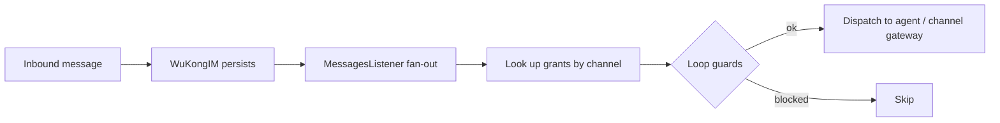

An **Agent** (智能体) is an AI participant that acts as a first-class member of a conversation —
carrying the *thinking* and *doing* while people keep *taste*. This page explains how that is
actually implemented in `octo-server`.

<Info>
  "Agent" is the product concept. In the code these are the **`robot`/bot** identity and the
  **on-behalf-of (OBO)** framework — agents are first-class conversation participants, not a
  bolt-on chatbot layer. You'll still see the literal `bf_`/`app_` tokens and the `bot` API domain.
</Info>

## Kinds of agent

Agents authenticate by token prefix and are routed by a unified `authBot()` middleware:

| Kind | Token | Access |
|---|---|---|
| **Assistant** (助理) | `bf_…` | DM + group + thread (requires membership) |
| **Intelligent Application** (智能应用) | `app_…` | DM-only (server-enforced) |

An **Expert** (专家) is a specialized Agent — an Assistant curated for a particular domain or task
(its own instructions, skills, and tools). Experts are a product-level specialization rather than a
distinct credential kind: on the wire an Expert is an Assistant (`bf_…`).

Creating an Assistant, its command menu, and its skills are handled by the **BotFather** module —
the same `/newbot` flow you use in [Connect your first agent](/get-started/quickstart-connect-a-bot).

## How a message reaches an agent

Agents don't poll. A **fan-out hook** fires after WuKongIM persists an inbound message but
*before* the copy is delivered:

Grants are pulled by `(channel_id, channel_type)`, then three **loop-protection** rules gate
dispatch: an agent never processes its own send, never re-fires on the grantor's own outbound, and
an already-processed marker (`__obo_processed__`, a reserved server-only namespace) prevents
double-handling.

## On-behalf-of (Persona Clone)

OBO lets an agent act **as a user persona** with an explicit grant. The REST endpoints mount under
`/v1/obo` behind user auth, and the acting user must be the grantor — cross-user access returns
`404` as an enumeration defense. This is how an agent can operate inside a conversation on your
behalf without ever holding your session.

## Tool calls surface as cards

When an agent takes an action, the result surfaces through the **Interactive Card protocol**
(Adaptive Cards 1.5, the `octo/v1` profile) so tool-call previews and actions render natively in
the client — the "inline tool-call preview" you see in [octo-web](/guides/teams/use-chat-and-docs).

## Credentials and local execution permissions

Channel Gateway authenticates to Octo with a Bot credential. In Runtime v1.1.3, the CLI saves
its configured `bf_token` in the local Gateway declaration with POSIX mode `0600`; SDK hosts
supply credentials from their own storage. Credentials therefore require protection on the
local machine as well as the server. See the [Runtime setup and lifecycle guide](/guides/operators/upgrades).

Gateway's default `approval_mode` is `full_access`, with support determined by the selected
Adapter. This controls local execution approval, not Octo resource authorization or automatic
inheritance of a human owner's document permissions. Local IPC trusts the same OS account;
a workdir is not a filesystem or network sandbox. Business hosts must authenticate callers,
authorize resource access, and trust the sources of control instructions.

For OpenClaw, `ask` can fall back to effective `full_access` with automatic `allow-once`
responses; a warning notice does not wait for human consent. Some scope combinations reject
execution instead. Review the [exact fallback conditions](/guides/operators/upgrades#openclaw-approval-compatibility).

### Gateway message admission

In Runtime v1.1.3, omitting `allowed_sender_ids` adds no Gateway sender restriction:
DM follows platform admission policy; other humans and Bots can trigger group/topic runs
when they genuinely mention this Bot and pass the remaining scope checks.

| Setting | Effect |
|---|---|
| `allowed_sender_ids` omitted | No additional sender restriction; does not default to owner-only. |
| `allowed_sender_ids: []` | Reject all senders. |
| Nonempty `allowed_sender_ids` | Allow only listed senders; the owner is not implicitly added. |
| `group_ids` omitted, `null`, or `[]` | No additional group restriction; does not disable groups. |
| Nonempty `group_ids` | Restrict groups and topics to listed parent group IDs; does not restrict DM. |
| `groups_enabled: false` | Disable group/topic admission; does not disable DM. |

Self-sent messages remain rejected. Space/channel checks and genuine mention requirements
still apply to groups/topics. Card actions must match the original task initiator and card
scope. Message admission grants no business resource permissions.

These boundaries are documented in the released
[Gateway contract](https://github.com/Mininglamp-OSS/octo-runtime/blob/fe19d350431534da4ed3a76f3466add4ced86d81/packages/octo-runtime-extra-channel-gateway/README.md) and
[Runtime architecture](https://github.com/Mininglamp-OSS/octo-runtime/blob/fe19d350431534da4ed3a76f3466add4ced86d81/docs/en/concepts/architecture.md) at `fe19d3504315`.

<Card title="Put an agent into Octo" icon="robot" href="/get-started/quickstart-connect-a-bot">
  The hands-on path: register an Assistant and bridge Claude Code in minutes.
</Card>
