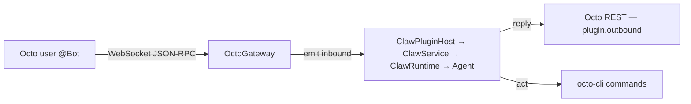

Choose the connection path that owns your Bot. Runtime Channel Gateway calls an existing OpenClaw Agent; the standalone OpenClaw plugin connects OpenClaw directly to Octo. The WorkBuddy Claw plugin is a separate integration described below.

| Your setup | Follow this path |
| --- | --- |
| Octo Runtime manages the Bot | [Runtime Channel Gateway](#runtime-channel-gateway-with-openclaw) with `config.bots` and `adapter.provider_agent_id`. |
| OpenClaw directly owns the Octo channel | [Standalone OpenClaw plugin](#openclaw-channel-octo) with `channels.octo.accounts`. |

<Note>
  BotFather's `create-openclaw-octo bind` / “current Session's Agent” instructions belong to the plugin path. They do not configure Runtime Channel Gateway. The plugin remains a separate supported connection option; switching paths does not remove it.
</Note>

## Runtime Channel Gateway with OpenClaw

This flow is scoped to [Runtime v1.1.10](https://github.com/Mininglamp-OSS/octo-runtime/releases/tag/v1.1.10), source [`f06546e915b1`](https://github.com/Mininglamp-OSS/octo-runtime/tree/f06546e915b155224a402703e5dae123daf854a5). Before configuring a Bot, prepare:

- An installed Runtime version matching this flow; check `octo-runtime --version` and `octo-runtime channel-gateway configure --help`. Follow the fixed [CLI setup](https://github.com/Mininglamp-OSS/octo-runtime/blob/f06546e915b155224a402703e5dae123daf854a5/docs/en/getting-started/cli.md) for installation and service prerequisites.
- An already running, authenticated OpenClaw Gateway with an existing Agent such as `main`. Prepare its connection/authentication for the Runtime host following the fixed [OpenClaw setup](https://github.com/Mininglamp-OSS/octo-runtime/blob/f06546e915b155224a402703e5dae123daf854a5/docs/en/guides/harnesses/openclaw.md). Runtime does not start that Gateway or create a missing Agent.
- The exact Bot ID and its `bf_` token from BotFather, plus the matching trusted Octo API URL. Copy only the Bot ID, without a display-name prefix such as `Octo bot`.

### Configure one Bot

Prepare a private JSON file using a trusted editor or your existing secret-management workflow. Keep it outside the repository and shared/synced directories, readable only by the intended account (owner-only permissions on POSIX, an equivalent Windows ACL). The following is a **new-install template** with placeholders, not usable credentials:

```json
{
  "module": "@mininglamp-oss/octo-runtime-extra-channel-gateway",
  "enabled": true,
  "config": {
    "bots": [{
      "bot_id": "<BOT_ID>",
      "api_url": "https://your-server.example/api",
      "bf_token": "<BOT_TOKEN>",
      "adapter": {
        "adapter_type": "openclaw",
        "provider_agent_id": "main"
      }
    }]
  }
}
```

For an existing Gateway, privately copy and review its complete current declaration first, then edit only the intended Bot. Preserve other Bots, `enabled`, `module`, and policy settings. **Do not apply this one-Bot template over an existing declaration:** `extraset` replaces the whole declaration and does not merge or preserve omitted settings.

In Bash/Zsh, read the protected file through stdin:

```bash
octo-runtime channel-gateway extraset < "/private/path/channel-gateway.json"
```

Only the file path enters the command line, not the token. Do not paste populated JSON into a shell here-string, use `--bf_token`, or substitute a token-valued shell variable into an argument: those approaches can expose credentials in history or process arguments. Stdin does not encrypt the private file or saved configuration. Do not share either file, `extraget` output, terminal recordings, or backups containing the token. The released [stdin implementation](https://github.com/Mininglamp-OSS/octo-runtime/blob/f06546e915b155224a402703e5dae123daf854a5/apps/cli/src/extras.ts) validates the declaration envelope; Bot/business validation happens when the Extra loads. Saving successfully is not authentication or startup acceptance.

The declaration is saved at `<home>/extras/channel-gateway/config.json`; even one Bot uses an array. For later non-secret changes, `configure` updates one `bot_id` and preserves omitted credentials and other Bots. This release has no `--credential-stdin` option for `configure`; use the complete-declaration stdin flow above for credentials. `adapter.provider_agent_id` selects the existing OpenClaw Agent (default `main` when omitted). It does not bind to the current OpenClaw Session or use the plugin's `/status` and `--agent` flow.

OpenClaw owns its workspace. Omit `adapter.workdir` and do not pass `--workdir` to `configure`; when switching an existing local-adapter entry, remove its old workdir from the reviewed full declaration. See the fixed [Gateway configuration contract](https://github.com/Mininglamp-OSS/octo-runtime/blob/f06546e915b155224a402703e5dae123daf854a5/packages/octo-runtime-extra-channel-gateway/README.md).

<Warning>
  Review the actual Gateway policy before starting. This version defaults `approval_mode` to `full_access`; OpenClaw `ask` can fall back to native full access when a usable manual approval channel or scopes are absent. Read the effective permission state, not only the requested policy. Check sender admission and local-file delivery settings in the fixed [configuration schema](https://github.com/Mininglamp-OSS/octo-runtime/blob/f06546e915b155224a402703e5dae123daf854a5/packages/octo-runtime-extra-channel-gateway/config-schema.json) and [Adapter limits](https://github.com/Mininglamp-OSS/octo-runtime/blob/f06546e915b155224a402703e5dae123daf854a5/packages/octo-runtime-adapter-openclaw/README.md).
</Warning>

### Start or reload the correct service

`configure` and `extraset` only save configuration. On first use, start Executor Kernel and Channel Gateway independently under the same Runtime Home:

```bash
octo-runtime executor-kernel start
octo-runtime channel-gateway start
```

`start` can install a missing user service and enable its autostart. If you use foreground processes instead, follow the fixed CLI setup's `run` lifecycle. After changing an already running registered Channel Gateway service, use:

```bash
octo-runtime channel-gateway restart
octo-runtime channel-gateway status
```

`restart` does not install a missing service. For a foreground Gateway, stop the old process before running it again. A connected Bot does not prove Kernel/Provider execution or reply delivery; send a small request without tools and inspect the actual reply.

## openclaw-channel-octo

[**`openclaw-channel-octo`**](https://github.com/Mininglamp-OSS/openclaw-channel-octo) is the standalone OpenClaw channel plugin, published exclusively on ClawHub. Use this path when OpenClaw owns the Octo channel directly, rather than configuring a Runtime Bot entry. This section covers [v1.5.3](https://github.com/Mininglamp-OSS/openclaw-channel-octo/releases/tag/v1.5.3), source [`b6d6fdf83e6f`](https://github.com/Mininglamp-OSS/openclaw-channel-octo/tree/b6d6fdf83e6f186a61044eb5bba7d727ea762b21). It requires Node ≥ 22 and OpenClaw ≥ 2026.6.9; also satisfy your installed OpenClaw version's own Node requirement. This version-specific procedure supports only a verified Octo plugin v1.5.3 installation. An unpinned installation alone is not supported by this procedure; the version and policy checks below are mandatory before account setup or Gateway startup.

<Warning>
  Review data visibility before installing or upgrading. `docTaskProgress` defaults to true and uploads document-task receipts and filtered tool input/output previews to `docsApiUrl`. **All readers of the target document can view them**, not just the requester. Previews may contain file contents, command output, and data from other systems. Credential filtering does not classify business secrets or guarantee removal of every secret. See the fixed [content policy](https://github.com/Mininglamp-OSS/openclaw-channel-octo/blob/b6d6fdf83e6f186a61044eb5bba7d727ea762b21/docs/doc-task-content-policy.md).

  `docTasks` and `botTasks` also default to true. Document commenters can task a Bot that can read the document, using that Bot's document permissions. Generic Bot Tasks trust the server event producer and can use the agent's configured non-Octo tools, including shell, filesystem, or browser tools. Disabling receipt uploads alone does not disable either task path.
</Warning>

### Set the account policy before starting

A running OpenClaw Gateway watches `channels.octo` and reconnects on configuration changes. Stop it using its existing lifecycle before installing/upgrading or changing accounts, so auto-reload cannot activate defaults before you review them.

With the Gateway still stopped, the release documents this command to install a candidate. It performs installation, not a download-only operation, and does not select a fixed plugin version or guarantee v1.5.3:

```bash
openclaw plugins install clawhub:octo
```

**Stop here before adding an account.** Confirm which installed Octo plugin directory this host will load. Read that directory's `package.json` and require `name: "octo"` and `version: "1.5.3"`, matching the [release metadata](https://github.com/Mininglamp-OSS/openclaw-channel-octo/blob/b6d6fdf83e6f186a61044eb5bba7d727ea762b21/package.json). The OpenClaw host version is not the Octo plugin version. Review the installed package's `openclaw.plugin.json` and `docs/doc-task-content-policy.md` against this release's task defaults, receipt visibility, and tool policy. Confirm package provenance through your trusted release process; a matching version string alone is not an integrity check.

If the loaded directory or provenance is uncertain, the plugin is not v1.5.3, or its contract differs, **keep the Gateway stopped and do not run `channels add` or start/resume it using this procedure**. Follow the documentation for the actual release or obtain the reviewed version through a verified upstream installation procedure. Do not assume a later version has the same defaults. This guide does not assert an unverified ClawHub version-selection flag or install path.

Only after those checks pass, use the interactive flow to select Octo and enter the account's token and trusted API URL without putting the token in shell arguments:

```bash
openclaw channels add
```

Account config lives in `~/.openclaw/openclaw.json` under `channels.octo.accounts`. Tokens can be `bf_` (Assistant, group and thread) or `app_` (Intelligent Application, DM-only). Interactive entry does not encrypt saved configuration; keep it private and do not share terminal recordings or populated config files.

For an IM-only account without document or generic background tasks, merge these boolean settings into the **existing account** before starting. Replace `my_bot` with its actual account key. This is a partial example, not a replacement config: preserve tokens, URLs, bindings, policy, and other accounts.

```json
{
  "channels": {
    "octo": {
      "accounts": {
        "my_bot": {
          "docTasks": false,
          "docTaskProgress": false,
          "botTasks": false
        }
      }
    }
  }
}
```

If you want document tasks and replies but no new receipt uploads, set only `docTaskProgress: false` instead. It does not remove stored receipts. Account settings take precedence over channel settings: an explicit account-level true overrides a channel-level false. Review each intended account rather than assuming a channel opt-out covers explicit overrides.

Before enabling document tasks or receipt uploads, deploy the companion Docs receipt endpoint and event-table migrations, then verify `docsApiUrl` against the fixed [upgrade instructions](https://github.com/Mininglamp-OSS/openclaw-channel-octo/blob/b6d6fdf83e6f186a61044eb5bba7d727ea762b21/README.md#upgrading-to-document-task-receipts) and [configuration contract](https://github.com/Mininglamp-OSS/openclaw-channel-octo/blob/b6d6fdf83e6f186a61044eb5bba7d727ea762b21/README.md#configuration). When omitted, `docsApiUrl` uses `apiUrl`; that origin must serve the required document routes. A receipt HTTP 404 stops reporting for that task, not its execution or comment reply. Missing receipts do not prove that nothing ran.

<Info>
  The plugin registers three agent tools: `octo_management`, `octo_send_display_card`, and `octo_send_card`. Restrictive profiles such as `coding` exclude plugin tools by default. Add only the intended tools through `tools.alsoAllow` rather than switching to `full` just to expose them. See the released [tool configuration](https://github.com/Mininglamp-OSS/openclaw-channel-octo/blob/b6d6fdf83e6f186a61044eb5bba7d727ea762b21/README.md#agent-tools).
</Info>

Start or resume the Gateway only after confirming that the plugin to be loaded is still v1.5.3 and each account's effective task, receipt, endpoint, and tool settings match your reviewed policy. If the installed plugin changes, repeat the release and policy review before proceeding. For a new foreground Gateway:

```bash
openclaw gateway run --force
```

For an existing managed Gateway, resume it through its existing lifecycle instead. Send a small IM request without tools and check the reply. A connected account or successful IM reply does not verify document permissions, task execution, or receipt delivery. This guide does not certify the backend's deployed version.

## claw-channel-octo

[**`claw-channel-octo`**](https://github.com/Mininglamp-OSS/claw-channel-octo) is the built-in WorkBuddy Claw channel plugin — it makes Octo IM a WorkBuddy remote-control channel, peer to WeCom / Feishu / DingTalk. It's a dual-system design:



- **OctoGateway** (the "ears") — a persistent WebSocket (JSON-RPC over WS) that receives inbound messages and emits them to the Claw runtime.
- **octo-cli** (the "hands") — the agent actively operates Octo via [`octo-cli`](/guides/bot-developers/drive-octo-with-cli) commands.

With `connectionMode: "websocket"`, replies go straight through `plugin.outbound` / Octo REST — not through an external webhook relay. Features: DM / group / thread, text / image / file, file upload, streaming replies (send → edit → final), auto-reconnect, 30 s heartbeat, and 5-minute dedup. Phases 1–2 are complete; the settings-panel UI (Phase 3) is pending.

<Card title="Compare all channels" icon="code-compare" href="/guides/bot-developers/choose-a-channel">
  See where OpenClaw and Claw sit relative to the other channels.
</Card>
