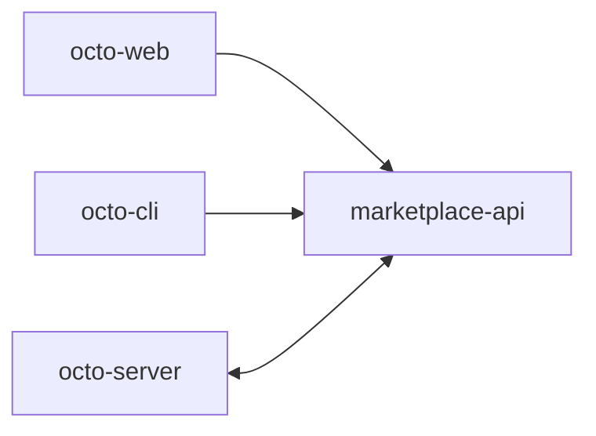

**[`octo-marketplace`](https://github.com/Mininglamp-OSS/octo-marketplace)** provides a
unified plugin catalog for Skills, connectors, experts, and expert teams.
Start with the [Marketplace concepts](/concepts/marketplace) for discovery and download.

<Info>
  The workflow below follows [octo-cli v0.19.5](https://github.com/Mininglamp-OSS/octo-cli/releases/tag/v0.19.5)
  and [Marketplace v0.8.0](https://github.com/Mininglamp-OSS/octo-marketplace/releases/tag/v0.8.0).
  The [generated CLI reference](/reference/octo-cli) remains a separately pinned
  v0.18.0 subset. Verify your deployed versions and Space review policy before publishing.
</Info>

## Where it sits



- **`octo-server`** verifies identity and authoritative Space membership.
- **`octo-marketplace`** owns catalog assets, version snapshots, publication, and policy.
- **The consumer runtime and installer** decide where and how downloaded Skills or MCP
  connections are installed. Downloading through `octo-cli` does not execute them.

The service exposes `/api/v1/*`. The Octo gateway's public prefix is
`/market/api/v1/*`; the gateway removes `/market` before forwarding.

## Save a Skill draft

Upload your archive, start parsing, and wait for the parse task to succeed before
importing it. The [released Skill workflow](https://github.com/Mininglamp-OSS/octo-cli/blob/7ffb7238756dcec639502ddb584b465fa770b6c1/skills/octo-marketplace/skills.md)
covers upload instructions, polling, and checking existing owned plugins before creation.

The following is a **new private draft** example. Replace the parse-task placeholder
with the completed task's identifier. `--plugin-name` is the human-facing title;
the stable machine name comes from the package. Omit `--plugin-id` when creating:

```bash
octo-cli marketplace plugin import \
  --parse-task-id 'COMPLETED_PARSE_TASK_ID' \
  --plugin-name "My Skill" --visibility private --version 1.0.0
```

Creation saves a draft and a version snapshot. It does not publish to the Space.
Tenant writes use `private` or `space`; `public` is no longer accepted.
Read the returned plugin before deciding to publish:

```bash
octo-cli marketplace plugin get --plugin-id 'PLUGIN_ID'
```

## Publish and check the outcome

Only publish the intended owned plugin after checking its content, version, and
visibility. Use the same version and matching notes as the draft you verified:

```bash
octo-cli marketplace plugin publish --plugin-id 'PLUGIN_ID' \
  --version 1.0.0 --changelog "Initial release"
```

- **Private:** publication completes immediately, but the plugin remains owner-only.
  The publish command ignores `--version` and `--changelog` in this branch; they do
  not change the version saved by import.
- **Space-visible:** the authenticated Space's review policy applies. With no stored
  override, automatic approval is enabled and publication completes immediately.
  If automatic approval is disabled, the draft remains pending review; retain the
  returned `review_id` for the Space owner/admin decision.
- **Already-published Space content:** direct `plugin import` and `plugin upsert`
  edits are rejected. Submit a frozen upgrade with `plugin review-request create`.
  A Skill upgrade needs a fresh completed parse task and the new version; see the
  [released update workflow](https://github.com/Mininglamp-OSS/octo-cli/blob/7ffb7238756dcec639502ddb584b465fa770b6c1/skills/octo-marketplace/skills.md#release-a-new-version).

<Warning>
  A publish or review-submission command can make Space content visible immediately.
  Do not treat review submission as a guaranteed pause for human approval.
  A `bf_` Bot uses its verified owner's identity and its own authoritative Space,
  but does not inherit the owner's Space administration role.
</Warning>

Re-read `plugin get` and inspect `display_status`, which can be `draft`,
`pending_review`, `published`, `rejected`, or `delisted`.
After a timeout or unknown result, inspect the plugin and review request before
retrying a mutation. Saving, submitting for review, publishing, downloading, and
installing are separate outcomes.

## Run the service locally

<Warning>
  The v0.8.0 repository's Compose stack is for local development: it explicitly sets
  `AUTH_ENABLED=false` and includes development credentials. The service's default
  of authentication enabled does not override that Compose setting.
  Do not expose this stack to an untrusted network or reuse it as a production deployment.
</Warning>

```bash
git clone --branch v0.8.0 --single-branch https://github.com/Mininglamp-OSS/octo-marketplace.git
cd octo-marketplace
docker compose up --build
```

The bundled Compose stack binds the API to `127.0.0.1:8092`. For a local Go process, follow the fixed-version
[setup instructions](https://github.com/Mininglamp-OSS/octo-marketplace/blob/99cc26100f83b1218de03ee257572cc3802de733/README.md#local-go-process),
including MySQL and the required environment configuration.

For an authenticated deployment, configure `AUTH_ENABLED=true`, the correct
`OCTO_API_URL` for identity verification, and deployment-managed database and storage
credentials. `MYSQL_DSN` is required; authenticated startup also requires `OCTO_API_URL`.
See the [v0.8.0 configuration guide](https://github.com/Mininglamp-OSS/octo-marketplace/blob/99cc26100f83b1218de03ee257572cc3802de733/CONFIGURATION.md).
Verify authentication and Space isolation in the target deployment; starting a
container or passing a health check is not that verification.

## Fixed contract sources

- [CLI v0.19.5 commands and lifecycle](https://github.com/Mininglamp-OSS/octo-cli/blob/7ffb7238756dcec639502ddb584b465fa770b6c1/skills/octo-marketplace/SKILL.md).
- Marketplace v0.8.0 [import](https://github.com/Mininglamp-OSS/octo-marketplace/blob/99cc26100f83b1218de03ee257572cc3802de733/internal/service/plugin/import.go),
  [publication](https://github.com/Mininglamp-OSS/octo-marketplace/blob/99cc26100f83b1218de03ee257572cc3802de733/internal/service/plugin/listing.go),
  [default review policy](https://github.com/Mininglamp-OSS/octo-marketplace/blob/99cc26100f83b1218de03ee257572cc3802de733/internal/repository/plugin/review_policy.go),
  and [development Compose configuration](https://github.com/Mininglamp-OSS/octo-marketplace/blob/99cc26100f83b1218de03ee257572cc3802de733/docker-compose.yaml).

<Card title="Author a Skill today" icon="puzzle" href="/guides/bot-developers/publish-a-skill">
  Author the capability, then choose its runtime install and catalog publication separately.
</Card>
