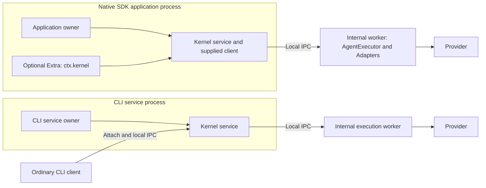
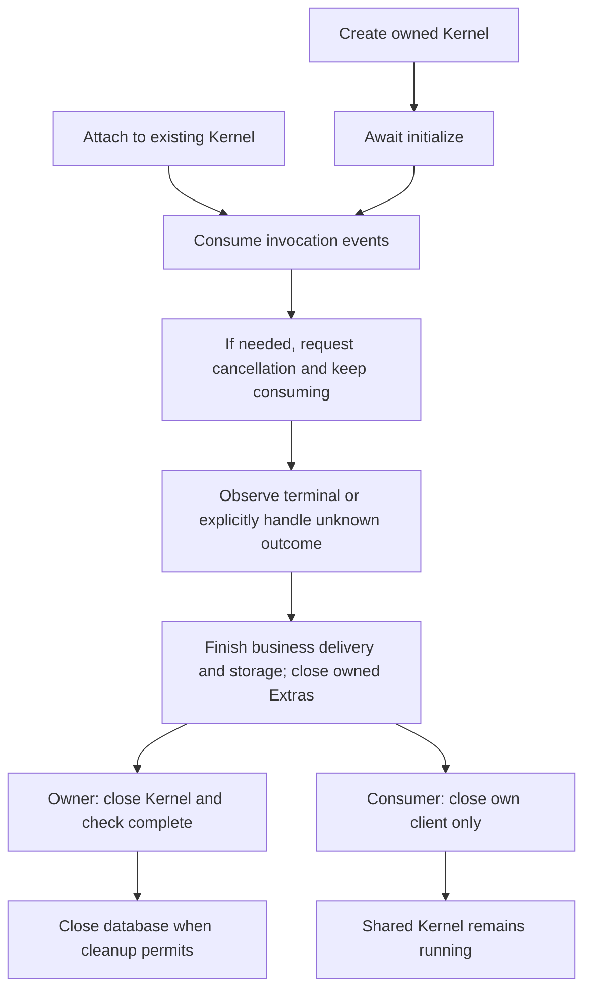

Use this guide to choose who starts Octo Runtime services and who only consumes them.
It describes published **Runtime v1.1.9**, fixed at [`58332b3bcf56`](https://github.com/Mininglamp-OSS/octo-runtime/blob/58332b3bcf5651f58e674fa236184dc6a0d927ca/docs/en/getting-started/sdk.md).
Host type alone does not decide between create and attach: **service ownership does**.
The [SDK reference](/reference/sdks) keeps the older version baselines and migration notes.

## Know the APIs before assembling a host

Functions below return objects implementing interfaces; `KernelService` and `KernelClient`
are not classes to construct with `new`. `AgentExecutor` is a concrete, lower-level class.

| API | Result and owner | Prerequisite and next step |
|---|---|---|
| `createKernelService(options)` | Function returning `KernelService`; the calling application owns it. | Choose a listening `endpoint` and absolute JavaScript `workerEntrypoint`. Construction is not readiness. |
| `KernelService.initialize()` / `status()` | Async initialization and service-status snapshot. | Await initialization before reading `kernel.client`; status is not Provider or business-delivery acceptance. |
| `KernelService.client` / `close()` | Supplied `KernelClient`; async close returns `ServiceCleanupResult`. | Normally use this client rather than attaching again just to execute. The owner checks `complete`, errors and pending resources. |
| `attachKernel({ endpoint })` | Function returning a `KernelClient` that connects when used. | Kernel must already be available at the host-supplied endpoint under the appropriate OS account. It starts no service. |
| `KernelClient.invoke(input, environment?)` | Async event iterator; consumption starts submission. | Supply valid invocation input and consume through terminal state; `break` only stops observation. |
| `cancelInvocation(invocationId, reason?)` / `respondInteraction(invocationId, response)` | Client controls for its registered invocation and matching interaction. | Keep invocation/interaction identities. Cancellation acceptance is not terminal state or cleanup. Native-mode responses use `respondNativeInteraction`. |
| `KernelClient.close()` | Synchronously releases this client's connections. | Does not stop the shared service or implicitly cancel accepted runs. |
| `serveWorker(adapters, options?)` | Worker-entry function returning void; creates an `AgentExecutor` and registers the supplied Adapters. | Compile/package this entry separately. Kernel supervises the worker; registration does not install or authenticate Providers. |
| `createExtraService(options)` | Function returning the `ExtraService` lifecycle interface. | Supply endpoint, plugin module, JSON config and dependencies; initialize it. Plugin `ExtraContext` supplies `ctx.kernel`; the Extra borrows Kernel, not its ownership. |

See the pinned [service lifecycle](https://github.com/Mininglamp-OSS/octo-runtime/blob/58332b3bcf5651f58e674fa236184dc6a0d927ca/packages/octo-runtime-executor-kernel/src/lifecycle.ts),
[client interface](https://github.com/Mininglamp-OSS/octo-runtime/blob/58332b3bcf5651f58e674fa236184dc6a0d927ca/packages/octo-runtime-executor-kernel/src/types.ts) and
[Extra contract](https://github.com/Mininglamp-OSS/octo-runtime/blob/58332b3bcf5651f58e674fa236184dc6a0d927ca/packages/octo-runtime-host-sdk/src/extras.ts).

### Use the right import surface

For the published package, pin `@mininglamp-oss/octo-runtime@1.1.9`. Keep source integration
on the matching commit and build its selected workspace packages; workspace names are not
additional npm subpaths of the root package.

| Purpose | Published import | Source/workspace import |
|---|---|---|
| Service construction | `@mininglamp-oss/octo-runtime/host` | `createKernelService` from `@mininglamp-oss/octo-runtime-executor-kernel`; `createExtraService` from `@mininglamp-oss/octo-runtime-host-sdk` |
| Client, worker and their types | `@mininglamp-oss/octo-runtime/executor-kernel` | `@mininglamp-oss/octo-runtime-executor-kernel` |
| `AgentExecutor` class | `@mininglamp-oss/octo-runtime/executor-core` | `@mininglamp-oss/octo-runtime-executor-core` |
| `ExtraContext` and plugin types | `@mininglamp-oss/octo-runtime/extra` | `@mininglamp-oss/octo-runtime-host-sdk/extra` |

The [package exports](https://github.com/Mininglamp-OSS/octo-runtime/blob/58332b3bcf5651f58e674fa236184dc6a0d927ca/package.json), [host facade](https://github.com/Mininglamp-OSS/octo-runtime/blob/58332b3bcf5651f58e674fa236184dc6a0d927ca/public/host.ts)
and [Kernel facade](https://github.com/Mininglamp-OSS/octo-runtime/blob/58332b3bcf5651f58e674fa236184dc6a0d927ca/public/executor-kernel.ts) define these surfaces.
Direct `AgentExecutor` integration is an explicit alternative: the caller registers
Adapters and owns execution and shutdown in its own process unless it supplies isolation.
It does not acquire Kernel's IPC/worker supervision automatically. Prefer `KernelClient`
for product integration; see the [Core implementation](https://github.com/Mininglamp-OSS/octo-runtime/blob/58332b3bcf5651f58e674fa236184dc6a0d927ca/packages/octo-runtime-executor-core/src/index.ts).

## Choose by service ownership

| Scenario | Choose | Who initializes and closes? |
|---|---|---|
| Application owns Kernel, including an Electron main process | `createKernelService`, then `kernel.client`. | Application assembly awaits `initialize()` and checks owned-service cleanup. |
| Application consumes an existing Kernel | Inject the host's client or `attachKernel({ endpoint })`. | Service owner manages Kernel; caller closes only clients it owns. |
| Bundled Runtime CLI hosts a service | CLI service entry uses the same SDK factory in its service process. | CLI/service manager owns service registration, process and autostart; the SDK factory does not register OS services. |
| Ordinary Runtime CLI client command consumes a service | CLI attaches to the existing endpoint, for example adapter listing. | Command closes its client; this does not stop Kernel. |

Here Runtime CLI means `octo-runtime`, separate from the `octo-cli` business REST client.
Gateway and Kernel services remain independently owned. See the fixed
[CLI assembly](https://github.com/Mininglamp-OSS/octo-runtime/blob/58332b3bcf5651f58e674fa236184dc6a0d927ca/apps/cli/src/main.ts) and [integration contract](https://github.com/Mininglamp-OSS/octo-runtime/blob/58332b3bcf5651f58e674fa236184dc6a0d927ca/INTEGRATION.md).

These boundaries describe processes and ownership, not OS sandbox guarantees.
For Electron, construct native services in the main process; inject a client into application
modules through your application's trusted boundary. Package the internal JavaScript worker,
selected Adapters and their dependencies in your build. Do not use Runtime CLI or an
external Node launcher as the top-level SDK service integration. An attach-only consumer
instead requires an already managed, reachable endpoint and an owner responsible for its
lifetime. Electron does not turn an arbitrary endpoint into an owned service.

## Follow the lifecycle through cleanup

At shutdown, stop admitting work and use the client invocation lifecycle where needed.
A cancellation ACK, execution terminal event, invocation drain, service cleanup and completed
business delivery are different facts. Close Extras and finish their delivery/storage work
before closing the owned Kernel and database. Check `close().complete`; retain and handle
pending resources when cleanup is incomplete rather than declaring shutdown complete.
An attached client never gains ownership by waiting for a run. See the
[pinned shutdown contract](https://github.com/Mininglamp-OSS/octo-runtime/blob/58332b3bcf5651f58e674fa236184dc6a0d927ca/packages/octo-runtime-executor-kernel/src/types.ts)
and [service example](https://github.com/Mininglamp-OSS/octo-runtime/blob/58332b3bcf5651f58e674fa236184dc6a0d927ca/docs/examples/service.mts).

## Continue with the official Node examples

Use Node.js 24.x or 26.x for these Node examples, with the selected Provider installed and
authenticated separately. Download raw files from this same revision, retain their helper
imports, and use the pinned package version above:

- [Attach example](https://github.com/Mininglamp-OSS/octo-runtime/blob/58332b3bcf5651f58e674fa236184dc6a0d927ca/docs/examples/attach.mts) and [invoke helper](https://github.com/Mininglamp-OSS/octo-runtime/blob/58332b3bcf5651f58e674fa236184dc6a0d927ca/docs/examples/invoke.mts):
  need a running Kernel, its actual endpoint, and the selected Provider installed/authenticated
  on the execution machine. The example consumes events, cancels requested interactions,
  reports execution failures, and closes the client while leaving Kernel running.
- [Owned-service helper](https://github.com/Mininglamp-OSS/octo-runtime/blob/58332b3bcf5651f58e674fa236184dc6a0d927ca/docs/examples/service.mts) and the complete
  [Node SDK quickstart](https://github.com/Mininglamp-OSS/octo-runtime/blob/58332b3bcf5651f58e674fa236184dc6a0d927ca/docs/en/getting-started/sdk.md): provide endpoint and compiled
  worker, await initialization, consume final status, cancel when needed, then inspect cleanup.
  The linked DSH example additionally requires its documented DSH installation and `DSH_BIN`;
  it explicitly uses `full_access` and is not a generic Electron permission template.

The published quickstart already uses `attachKernel({ endpoint })`. These are Node examples,
not an Electron packaging recipe or proof of native Electron validation. Validate worker
paths, dependency packaging, startup and cleanup in your target Electron environment.
Hosts still own configuration, credentials, session persistence and databases. Follow
[version compatibility and interaction boundaries](/reference/sdks) and
[deployment lifecycle](/guides/operators/upgrades) without treating this guide as approval
or production acceptance.
