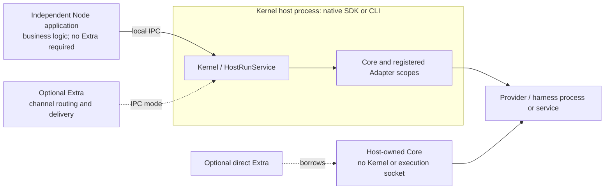

Your Node.js application can invoke an existing local Executor Kernel **without writing or starting an Extra**. Install the standalone client and use the endpoint supplied by the Kernel owner. Your application owns its business authentication, permissions, input/context construction, event handling, session persistence, interaction UI and result delivery.

This guide targets the [formal Runtime v1.1.11 release](https://github.com/Mininglamp-OSS/octo-runtime/releases/tag/v1.1.11), published on 2026-11-05, at commit [`780cd7cd5e67`](https://github.com/Mininglamp-OSS/octo-runtime/tree/780cd7cd5e67e4868df895a2e74a826097f349fd). It does not describe draft releases or deployment status. Keep the [v1.1.9 orientation](/guides/integrators/runtime-sdk-orientation) and [v1.1.10 migration](/guides/integrators/runtime-v1110-migration) for those versions.

## Choose by ownership

All package entries below are for **1.1.11**. Short subpaths in the table belong to `@mininglamp-oss/octo-runtime`.

| Approach | Package and public entry | Kernel / Extra required? | Ownership and reason to choose it |
|---|---|---|---|
| Standalone client | `@mininglamp-oss/octo-runtime-client`, root `attachKernel({ endpoint })`; types/validation at `/protocol` | Existing Kernel; no Extra | The service owner starts/stops Kernel. Your independent Node application owns business integration, its calls and connections. Choose this when execution is already hosted. |
| Native Kernel host | Full Runtime; `/executor-kernel` or `/host`: `createKernelService`; `/host`: `componentEndpoint` | Creates Kernel; Extra optional | Your host supplies prepared Home and actual Adapter objects, awaits `initialize()`, uses `kernel.client`, then closes owned services. Choose this when your product owns execution lifecycle. |
| Direct Core | Full Runtime; `/executor-core`: `AgentExecutor`; `/adapters/codex`: `createCodexAdapter` | Neither | Your host registers Adapters, consumes `executor.invoke`, owns business logic, and awaits `executor.shutdown()`. Choose deliberate in-process embedding without Kernel admission/IPC/reconnection. |
| Extra integration | Full Runtime; `/host`: `createExtraService`; module such as `/extras/channel-gateway` | IPC: existing Kernel. Direct: borrowed Core. Extra required for this approach only | Host owns plugin lifecycle/configuration; plugin owns its channel authentication, routing, calls and delivery. Choose when those responsibilities belong in a reusable plugin. Closing Extra does not close shared Core/Kernel. |
| CLI deployment | Full Runtime; `octo-runtime` executable, e.g. `executor-kernel run` or `start` | Hosts Kernel; Extras separately optional | CLI/service manager owns deployment and lifecycle. A standalone client can consume that Kernel without using CLI as its business API. `start` can install the component and enable autostart; use the fixed [CLI guide](https://github.com/Mininglamp-OSS/octo-runtime/blob/780cd7cd5e67e4868df895a2e74a826097f349fd/docs/en/getting-started/cli.md) deliberately. |

These choices combine: either a native SDK host or CLI can provide the Kernel for a standalone client; neither needs an Extra. Runtime CLI (`octo-runtime`) is distinct from the business API tool `octo-cli`. Electron/Tauri products use SDK integration, not CLI launching or terminal-output parsing as their business layer. Electron composition belongs in the main process; browser/renderer code does not directly use this Node client. This guide does not supply or validate a Tauri bridge or Electron packaging recipe.



Since v1.1.10 there is **no execution worker or `serveWorker`**. Kernel, Core and injected Adapter objects share the host process and failure domain; local RPC does not isolate blocking, process exit or out-of-memory failures. Provider subprocesses are a separate Adapter responsibility.

## Prepare the existing service

Use **Node.js 24 or 26** and pair client **1.1.11** with Runtime **1.1.11**. The client archive includes the shared protocol, but no CLI, server, Core, Provider Adapter or Extra. Installing it or calling `attachKernel` does not initialize Home, install/authenticate a Provider, start Kernel or create an Extra.

Before invoking, have the service owner confirm:

1. Kernel is running with the required Adapter registered. The example selects Codex; its harness must already be installed and authenticated in the **Kernel host's** environment. Registration and a successful `status()` query do not prove Provider readiness or model access.
2. The supplied endpoint is the local Unix socket or Windows named pipe for that Kernel. POSIX v1.1.11 uses `<home>/executor-kernel.sock`; do not pass the Home directory, an Extra control socket or a URL. On Windows obtain the derived pipe name from the host, rather than constructing a POSIX path.
3. The selected work directory exists, is authorized for this caller, and is accessible to the Provider. A working directory, Context JSON validation and a prompt asking not to use tools are not sandbox or authorization controls.

Local IPC trusts the existing OS account. Separate processes do not add remote authentication, HTTP/WebSocket transport, browser execution or cross-device routing. Your application must authorize incoming users and resource access before constructing trusted execution/security Context; never copy untrusted policy or environment settings straight into a call.

## Run a complete external Node example

In a new application directory, install the fixed client version. These are reader setup commands; installing client does not start a service.

```bash
npm init -y
npm install --save-exact @mininglamp-oss/octo-runtime-client@1.1.11
```

Save the following as `main.mts`. Node 24/26 runs this TypeScript directly. It sends one concrete text input with Context v3, Codex selection, a fixed work directory, `ask` approvals and a 60-second execution budget. It starts a fresh business session; it does not demonstrate persistence or Provider session continuation.

```typescript
import { randomUUID } from "node:crypto";
import { stat } from "node:fs/promises";
import { isAbsolute } from "node:path";
import { attachKernel, KernelError } from "@mininglamp-oss/octo-runtime-client";
import { InvokeInput } from "@mininglamp-oss/octo-runtime-client/protocol";

const workdir = process.env.WORKDIR;
if (!workdir || !isAbsolute(workdir) || !(await stat(workdir)).isDirectory())
  throw new Error("WORKDIR must be an existing absolute directory");

const input = {
  invocationId: randomUUID(),
  sessionId: randomUUID(),
  runId: randomUUID(),
  protocol_mode: "canonical" as const,
  inputs: [{ type: "text" as const, text: "Reply with hello. Do not use tools." }],
  contexts: {
    schema: "octo.context-envelope/v3" as const,
    items: [
      { namespace: "octo.execution", name: "adapter", payload: { type: "codex" } },
      { namespace: "octo.execution", name: "workspace", payload: { mode: "fixed", path: workdir } },
      { namespace: "octo.security", name: "approval_policy", payload: { mode: "ask" } },
      { namespace: "octo.execution", name: "limits", payload: { run_timeout_ms: 60000 } }
    ]
  }
} satisfies InvokeInput;
InvokeInput.check(input);

if (process.argv.includes("--check-input")) {
  console.log("Input structure valid; no Kernel connection or Provider call made.");
} else {
  const endpoint = process.env.KERNEL_ENDPOINT;
  if (!endpoint) throw new Error("KERNEL_ENDPOINT must be supplied by the Kernel owner");
  const client = attachKernel({ endpoint });
  let terminal: string | undefined;
  let stopping: Promise<void> | undefined;
  let cancellationRequested = false;
  const stop = () => stopping ??= (async () => {
    client.invocations.stopAdmission();
    try {
      const result = await client.invocations.drain({
        deadline: Date.now() + 5000, reason: "standalone application exit"
      });
      if (!result.complete) {
        console.error("Unresolved invocations; preserve these identities for investigation:", result.unresolved);
        process.exitCode = 1;
      }
    } finally {
      client.close();
    }
  })();
  const onStop = () => { void stop().catch(() => { process.exitCode = 1; }); };
  process.once("SIGINT", onStop);
  process.once("SIGTERM", onStop);
  const timer = setTimeout(onStop, 65000);
  try {
    for await (const event of client.invoke(input)) {
      if (event.type === "message.delta" && typeof event.payload.text === "string")
        process.stdout.write(event.payload.text);
      if (event.type === "interaction.requested" && event.payload.delivery !== "async" && !cancellationRequested) {
        cancellationRequested = true;
        try {
          await client.cancelInvocation(input.invocationId, "example has no interaction UI");
        } catch (error) {
          console.error(error instanceof KernelError ? error.code : "CANCEL_FAILED");
          process.exitCode = 1;
        }
      }
      if (["run.completed", "run.failed", "run.cancelled"].includes(event.type)) {
        terminal = event.type;
        console.error("Execution terminal:", terminal);
      }
    }
    if (terminal !== "run.completed") process.exitCode = 1;
  } catch (error) {
    console.error(error instanceof KernelError ? error.code : "INVOCATION_FAILED");
    process.exitCode = 1;
  } finally {
    clearTimeout(timer);
    process.off("SIGINT", onStop);
    process.off("SIGTERM", onStop);
    await stop();
  }
}
```

First validate only the input locally. Set `WORKDIR` to an existing directory you authorize; the sample path is illustrative. `--check-input` does not attach to Kernel.

```bash
export WORKDIR="/absolute/authorized/project"
node main.mts --check-input
```

For a real call, also obtain `KERNEL_ENDPOINT` from the service owner, then run the same file without the flag. This command invokes the configured Provider and may incur usage or tool effects; the text prompt is not a security policy. This POSIX example assumes the owner's Home is `/absolute/runtime-home`; on Windows set the host-supplied named pipe in your shell instead.

```bash
export KERNEL_ENDPOINT="/absolute/runtime-home/executor-kernel.sock"
node main.mts
```

Only `run.completed` indicates successful execution. A failed or cancelled terminal sets a nonzero exit status; execution failure may arrive as `run.failed` without throwing. Canonical `invoke` yields `CanonicalEvent` directly, not `HostFrame.event`. Text output is demonstration output, not a durable result delivery receipt.

The example cancels the first synchronous interaction because it has no UI, then keeps observing. It ignores optional questions marked `payload.delivery === "async"` and continues; they are not blocking approval requests. It never automatically answers or grants approval. A real product should implement its own interaction and delivery contract.

SIGINT/SIGTERM or the 65-second application timer stops admission, requests cancellation/drain of this client's registered calls with a five-second absolute deadline, then closes connections. Normal completion also checks drain. Incomplete drain is reported with the original identities; no invocation is automatically resubmitted. Preserve unresolved records in your own durable incident/session storage before using this pattern in a long-lived product. This console demo provides no crash recovery or durable storage.

For optional static checking, use a reviewed TypeScript compiler and Node 24 types with `--strict --noEmit --module NodeNext --moduleResolution NodeNext --target ES2022 main.mts`. The checks behind this guide used the official client archive, TypeScript 5.9.3, Node types 24.13.5 and Node 24.22.1: strict typecheck and the pure `--check-input` path passed. **No real Kernel/Provider invocation, Windows run, Electron/Tauri packaging, authentication or deployment acceptance was performed.**

## Handle outcomes and close only what you own

`invoke` submits when consumption begins and owns bounded invocation registration and observation recovery. `submit`/`subscribe` are advanced APIs: callers own Run references, cancellation and observation themselves. A lost submission ACK is queried using its original identity. Recovery is bounded and is not persistent history; do not automatically resubmit an execution after an unknown outcome or restart.

Cancellation ACK, execution terminal, resource cleanup and business persistence/delivery are separate facts. Breaking iteration or calling `client.close()` only stops observation/connections, not accepted work or the shared Kernel. `invocations.drain({ deadline, reason })` requests cancellation and queries registered calls until the absolute `Date.now()` deadline; `complete` only describes that registry, not Provider process cleanup or your business delivery. A new explicit user Stop may retry cancellation after a failure/unknown result in v1.1.11; signal/drain does not blindly resend an unknown control action. Preserve errors such as `RUN_OUTCOME_UNKNOWN` or `OPERATION_OUTCOME_UNKNOWN` for investigation.

A product owner stops new work, drains its calls, finishes its business consumers and persistence/delivery within its shutdown budget, then closes the client. An attached client never closes the shared Kernel. A native service owner also closes its Extras before its Kernel and checks each awaited service result's `complete`; a direct Core owner awaits `shutdown()` and inspects `cleanup`. Bare `AgentExecutor.invoke` requests cancellation when its iterator ends early; an Extra direct scope instead owns independent observation, where stopping observation does not cancel accepted work.

The Codex Adapter's registered **Core scope** owns compatible resident app-server processes. Normal completion, cancellation and Extra closure release the invocation, not the shared app-server. Only the Core/Kernel owner closes that service scope. Bounded Provider service recovery does not replay prior business/control requests and is not automatic recovery of a crashed application host. Check the fixed [Codex lifecycle and platform limits](https://github.com/Mininglamp-OSS/octo-runtime/blob/780cd7cd5e67e4868df895a2e74a826097f349fd/packages/octo-runtime-adapter-codex/README.md), especially Windows leader/descendant limitations.

## Migrate service hosts and Extras to v1.1.11

- **Prepare Home explicitly.** SDK Kernel and IPC Extra services require the host's existing absolute `home`; SDK has no default Home, does not expand `~`, create the root or choose a fallback. The host prepares it, then supplies `home`, `endpoint` and actual Adapter objects. Initialization validates before owned resources are created. Keep startup failure/rollback details and inspect cleanup; do not erase identity/configuration to cure a path error. `resolveHostHome(appId)` is removed; `componentEndpoint(home)` only derives/validates an address, not directory existence.
- **Coordinate the endpoint change.** Stop old processes, update Kernel and all clients/Extras together, then restart with the direct POSIX `<home>/executor-kernel.sock` address. Windows pipe naming and Extra control addresses are unchanged. No automatic old-socket fallback or compatibility negotiation is added.
- **Keep existing data and CLI intent.** CLI selects explicit `--home`, otherwise `~/.octo-runtime`, and prepares that root. Old environment/platform defaults no longer select Home; use `--home` to retain a former location. Existing service definitions retain their explicit location. No automatic data move or identity reset is implied.
- **Select Extra execution deliberately.** `createExtraService({ home, execution: { kind: "ipc", endpoint }, module, config, dependencies })` connects to an existing Kernel. `createExtraService({ execution: { kind: "direct", executor }, module, config, dependencies })` borrows a Core from the same Runtime installation and can omit Home when no Home-backed resources are requested. Plugins use `context.execution`. Legacy top-level `{ home, endpoint, ... }` remains supported, but cannot be combined with `execution`. Closing either Extra mode affects only its own calls/resources; the host owns shared Core/Kernel shutdown. Direct mode does not provide IPC reconnection, durable replay or process isolation.
- **Use this version's exports.** v1.1.11 adds public `/adapters/codex`; the v1.1.10 note about its absence remains historical. Full Runtime `/executor-kernel` and `/protocol` remain supported. Do not import the client's `/internal` composition helpers as a stable application API. Installing both distributions can create distinct module copies; use the error class from the producing API or its public `code`, not cross-package `instanceof` assumptions.

Package versions differ from IPC v1, Run 7 and Context v3. Match the release pair; arbitrary cross-version interoperability is not promised. `status()` rejects unsupported IPC with `KERNEL_IPC_VERSION_UNSUPPORTED` and malformed status with `INVALID_RESPONSE`; submission performs this status check before writing the invocation. There is no version negotiation, downgrade or compatibility translation.

## Fixed source contracts

All links below use the released commit, not moving `main` or issue proposals:

- [Client package and compatibility](https://github.com/Mininglamp-OSS/octo-runtime/blob/780cd7cd5e67e4868df895a2e74a826097f349fd/packages/octo-runtime-client/README.md), [public exports](https://github.com/Mininglamp-OSS/octo-runtime/blob/780cd7cd5e67e4868df895a2e74a826097f349fd/package.json), [client types/ownership](https://github.com/Mininglamp-OSS/octo-runtime/blob/780cd7cd5e67e4868df895a2e74a826097f349fd/packages/octo-runtime-client/src/types.ts).
- [Input contract](https://github.com/Mininglamp-OSS/octo-runtime/blob/780cd7cd5e67e4868df895a2e74a826097f349fd/docs/en/reference/invoke-input.md), [output/control](https://github.com/Mininglamp-OSS/octo-runtime/blob/780cd7cd5e67e4868df895a2e74a826097f349fd/docs/en/reference/output-and-control.md), [client implementation](https://github.com/Mininglamp-OSS/octo-runtime/blob/780cd7cd5e67e4868df895a2e74a826097f349fd/packages/octo-runtime-client/src/client.ts), [invocation lifecycle](https://github.com/Mininglamp-OSS/octo-runtime/blob/780cd7cd5e67e4868df895a2e74a826097f349fd/packages/octo-runtime-client/src/invocation-lifecycle.ts).
- [Home validation/migration](https://github.com/Mininglamp-OSS/octo-runtime/blob/780cd7cd5e67e4868df895a2e74a826097f349fd/docs/en/reference/runtime-home.md), [native SDK and Extra modes](https://github.com/Mininglamp-OSS/octo-runtime/blob/780cd7cd5e67e4868df895a2e74a826097f349fd/docs/en/getting-started/sdk.md), [Extra options/ownership](https://github.com/Mininglamp-OSS/octo-runtime/blob/780cd7cd5e67e4868df895a2e74a826097f349fd/packages/octo-runtime-host-sdk/src/extra-service.ts).
