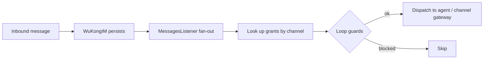

**智能体（Agent）**是作为对话一等成员的 AI 参与者——承担*思考*与*执行*，而把*品味*留给人类。本页解释这一理念在 `octo-server` 中究竟是如何实现的。

<Info>
  “智能体”是产品层面的概念。在代码中，它对应 **`robot`/bot** 身份与 **代理执行（on-behalf-of，OBO）** 框架——智能体是一等对话参与者，而非附加的聊天机器人层。你仍会看到字面的 `bf_`/`app_` 令牌与 `bot` API 领域。
</Info>

## 智能体的类型

智能体按令牌前缀进行认证，并由统一的 `authBot()` 中间件路由：

| 类型 | 令牌 | 访问范围 |
|---|---|---|
| **助理（Assistant）** | `bf_…` | 私聊 + 群聊 + 话题（需要成员资格） |
| **智能应用（Intelligent Application）** | `app_…` | 仅私聊（由服务端强制） |

**专家（Expert）**是一种特化的智能体——为特定领域或任务定制的助理（拥有自己的指令、Skill 与工具）。专家是产品层面的特化，而非一种独立的凭证类型：在传输层上，专家就是一个助理（`bf_…`）。

创建助理、其命令菜单及其 Skill，都由 **BotFather** 模块处理——正是你在[连接你的第一个智能体](/zh/get-started/quickstart-connect-a-bot)中使用的那套 `/newbot` 流程。

## 消息如何抵达智能体

智能体并不轮询。在 WuKongIM 持久化一条入站消息之后、*但在*副本被投递*之前*，会触发一个**扇出钩子**：

授权（grant）按 `(channel_id, channel_type)` 拉取，随后三条**防环**规则对分发进行门控：智能体绝不处理自己发送的消息，绝不对授予者自身的出站消息再次触发，并且一个已处理标记（`__obo_processed__`，一个服务端保留的专用命名空间）可防止重复处理。

## 代理执行（人格克隆）

OBO 让智能体在获得明确授权后**以某个用户人格的身份**行动。其 REST 端点挂载于 `/v1/obo` 之下、位于用户认证之后，且行动用户必须是授予者——跨用户访问会返回 `404`，作为一种枚举防御。这正是智能体能在对话中代表你行动、却从不持有你会话的方式。

## 工具调用以卡片形式呈现

当智能体执行某个动作时，结果通过**交互式卡片协议**（Adaptive Cards 1.5，`octo/v1` 配置文件）呈现，使工具调用的预览与操作在客户端中原生渲染——也就是你在 [octo-web](/zh/guides/teams/use-chat-and-docs) 中看到的“内联工具调用预览”。

## 凭据与本地执行权限

Channel Gateway 使用 Bot 凭据向 Octo 认证。在 Runtime v1.1.3 中，CLI 将配置的 `bf_token`
保存在本地 Gateway 声明中，POSIX 权限为 `0600`；SDK 宿主从自有存储提供凭据。
因此，凭据在本地机器与服务端都需要保护。参见[Runtime 配置及生命周期指南](/zh/guides/operators/upgrades)。

Gateway 的 `approval_mode` 默认为 `full_access`，支持情况取决于所选 Adapter。
它控制本地执行审批，不代表 Octo 资源授权，也不代表自动继承人类所有者的文档权限。
本地 IPC 信任同一操作系统账号；workdir 不是文件系统或网络沙箱。
业务宿主必须认证调用者、授权资源访问，并确认控制指令来源可信。

对于 OpenClaw，`ask` 可能回退为有效 `full_access` 并自动回答 `allow-once`；
警告提示不会等待人工同意。部分 scopes 组合会改为拒绝执行。
请核对[准确的回退条件](/zh/guides/operators/upgrades#openclaw-审批兼容性)。

### Gateway 消息准入

Runtime v1.1.3 省略 `allowed_sender_ids` 时，Gateway 不额外限制发送者：
DM 沿用平台准入策略；其他用户与 Bot 只要在群 / 话题中真实点名当前 Bot 并通过其余范围检查，也能触发执行。

| 配置 | 效果 |
|---|---|
| 省略 `allowed_sender_ids` | 不增加发送者限制；不会默认仅允许 owner。 |
| `allowed_sender_ids: []` | 拒绝全部发送者。 |
| 非空 `allowed_sender_ids` | 只允许名单内发送者，owner 不会隐式补入。 |
| 省略 `group_ids`、`null` 或 `[]` | 不增加群范围限制；不会禁用群。 |
| 非空 `group_ids` | 按父群 ID 限制群与话题，不限制 DM。 |
| `groups_enabled: false` | 关闭群 / 话题准入，不关闭 DM。 |

自消息仍被拒绝。群 / 话题仍须通过 Space、频道与真实 @ 检查。
卡片操作必须匹配原任务发起者与原卡片范围。消息准入不授予业务资源权限。

以上边界见发行版 [Gateway 合同](https://github.com/Mininglamp-OSS/octo-runtime/blob/fe19d350431534da4ed3a76f3466add4ced86d81/packages/octo-runtime-extra-channel-gateway/README.md)与
[Runtime 架构](https://github.com/Mininglamp-OSS/octo-runtime/blob/fe19d350431534da4ed3a76f3466add4ced86d81/docs/zh-CN/concepts/architecture.md)，核实版本为 `fe19d3504315`。

<Card title="把一个智能体接入 Octo" icon="robot" href="/zh/get-started/quickstart-connect-a-bot">
  动手实践路径：几分钟内注册一个助理并桥接 Claude Code。
</Card>
