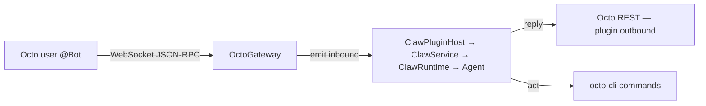

先按 Bot 的接入方选择路径。Runtime Channel Gateway 调用已有 OpenClaw Agent；独立
OpenClaw 插件则让 OpenClaw 直接连接 Octo。WorkBuddy Claw 插件是下文另述的独立集成。

| 你的部署方式 | 接入路径 |
|---|---|
| Octo Runtime 管理 Bot | [Runtime Channel Gateway](#runtime-channel-gateway-接入-openclaw)，使用 `config.bots` 和 `adapter.provider_agent_id`。 |
| OpenClaw 直接管理 Octo 频道 | [独立 OpenClaw 插件](#openclaw-channel-octo)，使用 `channels.octo.accounts`。 |

<Note>
  BotFather 的 `create-openclaw-octo bind` / “当前 Session 的 Agent”说明属于插件路径，
  不会配置 Runtime Channel Gateway。插件仍是独立有效的接入选项，切换路径不代表它被移除。
</Note>

## Runtime Channel Gateway 接入 OpenClaw

本流程固定为 [Runtime v1.1.10](https://github.com/Mininglamp-OSS/octo-runtime/releases/tag/v1.1.10)，
源码 [`f06546e915b1`](https://github.com/Mininglamp-OSS/octo-runtime/tree/f06546e915b155224a402703e5dae123daf854a5)。
配置 Bot 前准备好：

- 已安装与本流程匹配的 Runtime；检查 `octo-runtime --version` 和
  `octo-runtime channel-gateway configure --help`。安装与服务前提见固定版本的
  [CLI 指南](https://github.com/Mininglamp-OSS/octo-runtime/blob/f06546e915b155224a402703e5dae123daf854a5/docs/zh-CN/getting-started/cli.md)。
- 已运行、完成认证的 OpenClaw Gateway，以及其中已有的 Agent（例如 `main`）。按固定版本的
  [OpenClaw 配置指南](https://github.com/Mininglamp-OSS/octo-runtime/blob/f06546e915b155224a402703e5dae123daf854a5/docs/zh-CN/guides/harnesses/openclaw.md)
  为 Runtime 宿主准备连接与认证。Runtime 不会启动该 Gateway，也不会创建缺失的 Agent。
- BotFather 给出的准确 Bot ID、对应 `bf_` token，以及匹配的可信 Octo API URL。
  只复制 Bot ID，不要包含 `Octo bot` 等显示名称前缀。

### 配置单个 Bot

下列内容都是占位值，不是可用凭据。按私有凭据处理流程操作：token 参数可能进入 shell
历史或进程列表。不要分享填入凭据的命令、保存的完整声明或 `extraget` 输出。

```bash
octo-runtime channel-gateway configure \
  --bot_id "<BOT_ID>" \
  --api_url "https://your-server.example/api" \
  --adapter_type openclaw \
  --provider_agent_id main \
  --bf_token "<BOT_TOKEN>"
```

每次调用按 `bot_id` 添加或更新 `config.bots` 中的一项，保留省略字段及其他 Bot。
声明保存于 `<home>/extras/channel-gateway/config.json`；只有一个 Bot 也必须使用数组。
`adapter.provider_agent_id` 选择已有 OpenClaw Agent（省略时默认 `main`），不是绑定到
当前 OpenClaw Session，也不使用插件的 `/status` 和 `--agent` 流程。

OpenClaw Agent 自己管理工作区，不能传 `--workdir`。把已有本地 Adapter 条目改为 OpenClaw 时，
通过审核后的完整声明移除旧 `adapter.workdir`。`extraset` 会替换整份声明，不按 Bot ID 合并，
也不保留省略的 Bot 或设置。参见固定版本的
[Gateway 配置契约](https://github.com/Mininglamp-OSS/octo-runtime/blob/f06546e915b155224a402703e5dae123daf854a5/packages/octo-runtime-extra-channel-gateway/README.zh.md)。

<Warning>
  启动前核对实际 Gateway 策略。本版 `approval_mode` 默认 `full_access`；OpenClaw 的 `ask`
  在缺少可用人工审批通道或 scopes 时可能回退为原生 full access。应读取实际生效权限，
  不能只看请求的策略。另查固定版本
  [配置 schema](https://github.com/Mininglamp-OSS/octo-runtime/blob/f06546e915b155224a402703e5dae123daf854a5/packages/octo-runtime-extra-channel-gateway/config-schema.json)
  的发送者准入、本地文件交付设置及
  [Adapter 限制](https://github.com/Mininglamp-OSS/octo-runtime/blob/f06546e915b155224a402703e5dae123daf854a5/packages/octo-runtime-adapter-openclaw/README.zh.md)。
</Warning>

### 首次启动与重新加载

`configure` 仅保存配置。首次使用时，在相同 Runtime Home 下分别启动 Executor Kernel
和 Channel Gateway：

```bash
octo-runtime executor-kernel start
octo-runtime channel-gateway start
```

`start` 可能安装缺失的用户服务并开启其自启动。若使用前台进程，按固定 CLI 指南的 `run`
生命周期操作。修改已运行、已注册的 Channel Gateway 服务配置后使用：

```bash
octo-runtime channel-gateway restart
octo-runtime channel-gateway status
```

`restart` 不会安装缺失服务。前台 Gateway 则应先停止旧进程，再重新运行。
Bot 已连接不证明 Kernel/Provider 执行或回复交付成功；发送不使用工具的小请求，核对实际回复。

## openclaw-channel-octo

**[`openclaw-channel-octo`](https://github.com/Mininglamp-OSS/openclaw-channel-octo)** 是
独立 OpenClaw 频道插件，仅在 ClawHub 上独家发布。OpenClaw 直接管理 Octo 频道时使用此路径，
而不是配置 Runtime Bot 条目。

```bash
openclaw plugins install clawhub:octo
openclaw channels add --channel octo \
  --account my_bot \
  --bot-token bf_your_token_here \
  --http-url https://your-server.example/api
openclaw gateway run --force
```

需要 Node ≥ 22 以及 OpenClaw ≥ 2026.4.15。账号配置位于 `~/.openclaw/openclaw.json`
中的 `channels.octo.accounts` 下，并支持热重载。令牌可以是 `bf_`（助理，完整群组 +
话题）或 `app_`（智能应用，仅私聊）。

<Info>
  该插件注册了一个智能体工具，**`octo_management`**（群组、`GROUP.md`/`THREAD.md`、
  话题、成员、`write-secret`）。它仅在 `tools.profile: full` 下才被准入；全新
  安装默认使用 `coding` 配置，因此需通过 `tools.alsoAllow` 添加它。
</Info>

生命周期：REST 注册助理 → WebSocket 连接 → 自动重连 → 向拥有者问候 →
分发，并带有正在输入指示、已读回执，以及进度 / 展示卡片。

## claw-channel-octo

**[`claw-channel-octo`](https://github.com/Mininglamp-OSS/claw-channel-octo)** 是内置的
WorkBuddy Claw 频道插件——它让 Octo IM 成为一个 WorkBuddy 远程控制频道，与
WeCom / Feishu / DingTalk 并列。它是一种双系统设计：



- **OctoGateway**（“耳朵”）——一个持久的 WebSocket（JSON-RPC over WS），负责接收入站
  消息并把它们发送给 Claw 运行时。
- **octo-cli**（“手”）——智能体通过
  [`octo-cli`](/zh/guides/bot-developers/drive-octo-with-cli) 命令主动操作 Octo。

在 `connectionMode: "websocket"` 下，回复直接经由 `plugin.outbound` / Octo REST 发出——
而非经过外部 webhook 中继。功能：私聊 / 群组 / 话题、文本 / 图片 / 文件、文件
上传、流式回复（send → edit → final）、自动重连、30 秒心跳，以及 5 分钟
去重。阶段 1–2 已完成；设置面板 UI（阶段 3）待定。

<Card title="对比所有频道" icon="code-compare" href="/zh/guides/bot-developers/choose-a-channel">
  看看 OpenClaw 和 Claw 相对于其他频道处于什么位置。
</Card>
