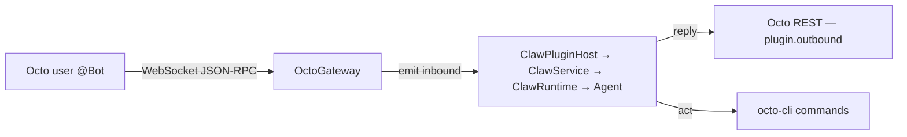

先按 Bot 的接入方选择路径。Runtime Channel Gateway 调用已有 OpenClaw Agent；独立 OpenClaw 插件则让 OpenClaw 直接连接 Octo。WorkBuddy Claw 插件是下文另述的独立集成。

| 你的部署方式 | 接入路径 |
| --- | --- |
| Octo Runtime 管理 Bot | [Runtime Channel Gateway](#runtime-channel-gateway-接入-openclaw)，使用 `config.bots` 和 `adapter.provider_agent_id`。 |
| OpenClaw 直接管理 Octo 频道 | [独立 OpenClaw 插件](#openclaw-channel-octo)，使用 `channels.octo.accounts`。 |

<Note>
  BotFather 的 `create-openclaw-octo bind` / “当前 Session 的 Agent”说明属于插件路径， 不会配置 Runtime Channel Gateway。插件仍是独立有效的接入选项，切换路径不代表它被移除。
</Note>

## Runtime Channel Gateway 接入 OpenClaw

本流程固定为 [Runtime v1.1.10](https://github.com/Mininglamp-OSS/octo-runtime/releases/tag/v1.1.10)， 源码 [`f06546e915b1`](https://github.com/Mininglamp-OSS/octo-runtime/tree/f06546e915b155224a402703e5dae123daf854a5)。 配置 Bot 前准备好：

- 已安装与本流程匹配的 Runtime；检查 `octo-runtime --version` 和 `octo-runtime channel-gateway configure --help`。安装与服务前提见固定版本的 [CLI 指南](https://github.com/Mininglamp-OSS/octo-runtime/blob/f06546e915b155224a402703e5dae123daf854a5/docs/zh-CN/getting-started/cli.md)。
- 已运行、完成认证的 OpenClaw Gateway，以及其中已有的 Agent（例如 `main`）。按固定版本的 [OpenClaw 配置指南](https://github.com/Mininglamp-OSS/octo-runtime/blob/f06546e915b155224a402703e5dae123daf854a5/docs/zh-CN/guides/harnesses/openclaw.md) 为 Runtime 宿主准备连接与认证。Runtime 不会启动该 Gateway，也不会创建缺失的 Agent。
- BotFather 给出的准确 Bot ID、对应 `bf_` token，以及匹配的可信 Octo API URL。 只复制 Bot ID，不要包含 `Octo bot` 等显示名称前缀。

### 配置单个 Bot

用可信编辑器或已有秘密管理流程准备私有 JSON 文件。不要放入仓库或共享/同步目录， 只允许预期账号读取（POSIX 使用仅所有者可访问的权限，Windows 使用等效 ACL）。 下面是**首次安装模板**，其中均为占位值，不是可用凭据：

```json
{
  "module": "@mininglamp-oss/octo-runtime-extra-channel-gateway",
  "enabled": true,
  "config": {
    "bots": [{
      "bot_id": "<BOT_ID>",
      "api_url": "https://your-server.example/api",
      "bf_token": "<BOT_TOKEN>",
      "adapter": {
        "adapter_type": "openclaw",
        "provider_agent_id": "main"
      }
    }]
  }
}
```

已有 Gateway 时，先私下复制并审核当前完整声明，再只修改目标 Bot。 保留其他 Bot、`enabled`、`module` 和策略设置。 **不要把此单 Bot 模板覆盖到现有声明上：**`extraset` 替换整份声明，不合并，也不保留省略设置。

在 Bash/Zsh 中，通过 stdin 读取受保护文件：

```bash
octo-runtime channel-gateway extraset < "/private/path/channel-gateway.json"
```

命令行只包含文件路径，不包含 token。不要把填好凭据的 JSON 粘贴进 shell here-string， 不要使用 `--bf_token`，也不要把含 token 的 shell 变量展开为参数； 这些方式可能让凭据进入历史或进程参数。 stdin 不会加密私有文件或保存后的配置。不要分享这些文件、`extraget` 输出、 终端录制或含 token 的备份。发行版的 [stdin 实现](https://github.com/Mininglamp-OSS/octo-runtime/blob/f06546e915b155224a402703e5dae123daf854a5/apps/cli/src/extras.ts) 只校验声明外层结构；Bot/业务校验在 Extra 加载时发生。 保存成功不代表认证或启动验收通过。

声明保存于 `<home>/extras/channel-gateway/config.json`；一个 Bot 也使用数组。 后续修改非秘密字段时，`configure` 按 `bot_id` 更新一项，保留省略的凭据及其他 Bot。 本版 `configure` 没有 `--credential-stdin` 选项；凭据使用上面的完整声明 stdin 流程。 `adapter.provider_agent_id` 选择已有 OpenClaw Agent（省略时默认 `main`），不是绑定到 当前 OpenClaw Session，也不使用插件的 `/status` 和 `--agent` 流程。

OpenClaw 自己管理工作区。省略 `adapter.workdir`，也不要向 `configure` 传 `--workdir`； 切换已有本地 Adapter 条目时，从审核后的完整声明中移除旧 workdir。参见固定版本的 [Gateway 配置契约](https://github.com/Mininglamp-OSS/octo-runtime/blob/f06546e915b155224a402703e5dae123daf854a5/packages/octo-runtime-extra-channel-gateway/README.zh.md)。

<Warning>
  启动前核对实际 Gateway 策略。本版 `approval_mode` 默认 `full_access`；OpenClaw 的 `ask` 在缺少可用人工审批通道或 scopes 时可能回退为原生 full access。应读取实际生效权限， 不能只看请求的策略。另查固定版本 [配置 schema](https://github.com/Mininglamp-OSS/octo-runtime/blob/f06546e915b155224a402703e5dae123daf854a5/packages/octo-runtime-extra-channel-gateway/config-schema.json) 的发送者准入、本地文件交付设置及 [Adapter 限制](https://github.com/Mininglamp-OSS/octo-runtime/blob/f06546e915b155224a402703e5dae123daf854a5/packages/octo-runtime-adapter-openclaw/README.zh.md)。
</Warning>

### 首次启动与重新加载

`configure` 和 `extraset` 仅保存配置。首次使用时，在相同 Runtime Home 下分别启动 Executor Kernel 和 Channel Gateway：

```bash
octo-runtime executor-kernel start
octo-runtime channel-gateway start
```

`start` 可能安装缺失的用户服务并开启其自启动。若使用前台进程，按固定 CLI 指南的 `run` 生命周期操作。修改已运行、已注册的 Channel Gateway 服务配置后使用：

```bash
octo-runtime channel-gateway restart
octo-runtime channel-gateway status
```

`restart` 不会安装缺失服务。前台 Gateway 则应先停止旧进程，再重新运行。 Bot 已连接不证明 Kernel/Provider 执行或回复交付成功；发送不使用工具的小请求，核对实际回复。

## openclaw-channel-octo

[**`openclaw-channel-octo`**](https://github.com/Mininglamp-OSS/openclaw-channel-octo) 是 独立 OpenClaw 频道插件，仅在 ClawHub 发布。OpenClaw 直接管理 Octo 频道时使用此路径， 而不是配置 Runtime Bot 条目。 本节对应 [v1.5.3](https://github.com/Mininglamp-OSS/openclaw-channel-octo/releases/tag/v1.5.3)， 源码 [`b6d6fdf83e6f`](https://github.com/Mininglamp-OSS/openclaw-channel-octo/tree/b6d6fdf83e6f186a61044eb5bba7d727ea762b21)。 需要 Node ≥ 22 和 OpenClaw ≥ 2026.6.9；还须满足所装 OpenClaw 版本自身的 Node 要求。 安装后核对实际插件版本：下面的 ClawHub 命令不会锁定到本文对应的发行版。

<Warning>
  安装或升级前先检查数据可见范围。`docTaskProgress` 默认开启，会向 `docsApiUrl` 上传文档任务回执及经过过滤的工具输入输出预览。**目标文档的全部读者都能查看**，不只是请求者。 预览可能包含文件正文、命令输出及其他系统的数据。凭据过滤不识别业务机密， 也不保证移除所有秘密。参见固定版本的 [内容政策](https://github.com/Mininglamp-OSS/openclaw-channel-octo/blob/b6d6fdf83e6f186a61044eb5bba7d727ea762b21/docs/doc-task-content-policy.md)。

  `docTasks` 和 `botTasks` 也默认开启。能够评论 Bot 可读文档的人，可以使用该 Bot 的文档权限指挥它执行任务。通用 Bot Tasks 信任服务端事件发起方，且可使用智能体已配置的 非 Octo 工具，包括 shell、文件系统或浏览器工具。只关闭回执上传不会关闭任一任务路径。
</Warning>

### 启动前设置账号策略

运行中的 OpenClaw Gateway 会监听 `channels.octo`，配置变化时重新连接。 安装、升级或修改账号前，先按原有生命周期停止 Gateway，避免自动重载在审核前启用默认设置。

安装插件，再使用交互流程选择 Octo，输入账号 token 和可信 API URL，避免把 token 放入 shell 参数：

```bash
openclaw plugins install clawhub:octo
openclaw channels add
```

账号配置位于 `~/.openclaw/openclaw.json` 的 `channels.octo.accounts` 下。 令牌可以是 `bf_`（助理，群组与话题）或 `app_`（智能应用，仅私聊）。 交互输入不会加密保存后的配置；保持其私密，不要分享终端录制或填入凭据的配置文件。

如果账号只用于 IM，不需要文档或通用后台任务，启动前把下列布尔设置合并到**既有账号**。 将 `my_bot` 替换为实际账号键。这只是局部示例，不是替换配置： 保留 token、URL、绑定、策略及其他账号。

```json
{
  "channels": {
    "octo": {
      "accounts": {
        "my_bot": {
          "docTasks": false,
          "docTaskProgress": false,
          "botTasks": false
        }
      }
    }
  }
}
```

如果仍需文档任务及回复、只想停止新回执上传，则仅设置 `docTaskProgress: false`。 它不会删除已保存回执。账号设置优先于渠道设置：显式账号级 true 会覆盖渠道级 false。 逐一检查目标账号，不要假设渠道级关闭设置能够覆盖账号的显式值。

启用文档任务或回执上传前，先部署配套 Docs 回执接口和事件表迁移，再按固定版本的 [升级说明](https://github.com/Mininglamp-OSS/openclaw-channel-octo/blob/b6d6fdf83e6f186a61044eb5bba7d727ea762b21/README.md#upgrading-to-document-task-receipts) 与 [配置契约](https://github.com/Mininglamp-OSS/openclaw-channel-octo/blob/b6d6fdf83e6f186a61044eb5bba7d727ea762b21/README.md#configuration) 核对 `docsApiUrl`。省略时会使用 `apiUrl`，该地址必须提供所需文档路由。 回执接口返回 HTTP 404 会停止该任务的上报，不会停止执行或评论回复。 缺少回执不证明任务没有运行。

<Info>
  插件注册三个智能体工具：`octo_management`、`octo_send_display_card` 和 `octo_send_card`。`coding` 等受限配置默认排除插件工具。 通过 `tools.alsoAllow` 只添加需要的工具，不要仅为开放它们就切换到 `full`。 参见发行版的 [工具配置](https://github.com/Mininglamp-OSS/openclaw-channel-octo/blob/b6d6fdf83e6f186a61044eb5bba7d727ea762b21/README.md#agent-tools)。
</Info>

审核设置后，首次启动前台 Gateway：

```bash
openclaw gateway run --force
```

已有托管 Gateway 则按原有生命周期恢复运行。发送不使用工具的小型 IM 请求并核对回复。 账号已连接或 IM 回复成功，不证明文档权限、任务执行或回执交付通过验收。 本指南不证明后端实际部署的版本。

## claw-channel-octo

[**`claw-channel-octo`**](https://github.com/Mininglamp-OSS/claw-channel-octo) 是内置的 WorkBuddy Claw 频道插件——它让 Octo IM 成为一个 WorkBuddy 远程控制频道，与 WeCom / Feishu / DingTalk 并列。它是一种双系统设计：



- **OctoGateway**（“耳朵”）——一个持久的 WebSocket（JSON-RPC over WS），负责接收入站 消息并把它们发送给 Claw 运行时。
- **octo-cli**（“手”）——智能体通过 [`octo-cli`](/zh/guides/bot-developers/drive-octo-with-cli) 命令主动操作 Octo。

在 `connectionMode: "websocket"` 下，回复直接经由 `plugin.outbound` / Octo REST 发出—— 而非经过外部 webhook 中继。功能：私聊 / 群组 / 话题、文本 / 图片 / 文件、文件 上传、流式回复（send → edit → final）、自动重连、30 秒心跳，以及 5 分钟 去重。阶段 1–2 已完成；设置面板 UI（阶段 3）待定。

<Card title="对比所有频道" icon="code-compare" href="/zh/guides/bot-developers/choose-a-channel">
  看看 OpenClaw 和 Claw 相对于其他频道处于什么位置。
</Card>
