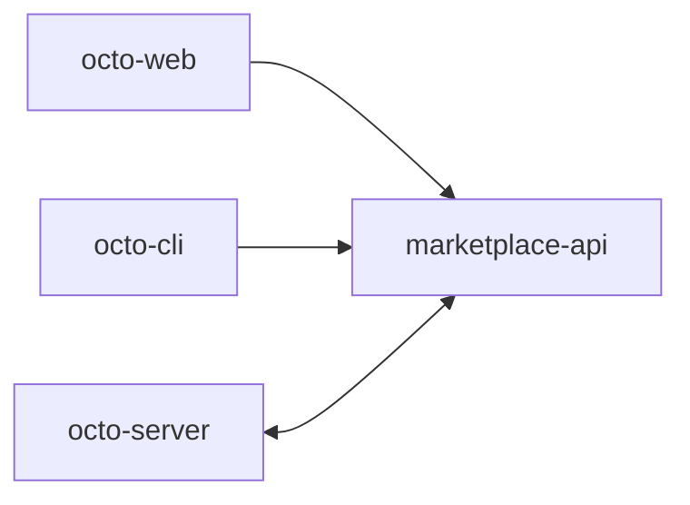

**[`octo-marketplace`](https://github.com/Mininglamp-OSS/octo-marketplace)**
为 Skill、连接器、专家和专家团提供统一插件目录。
发现与下载方式参见 [Marketplace 概念](/zh/concepts/marketplace)。

<Info>
  以下流程依据 [octo-cli v0.19.5](https://github.com/Mininglamp-OSS/octo-cli/releases/tag/v0.19.5)
  与 [Marketplace v0.8.0](https://github.com/Mininglamp-OSS/octo-marketplace/releases/tag/v0.8.0)。
  [生成式 CLI 参考](/zh/reference/octo-cli)仍单独固定于 v0.18.0 的已收录子集。
  发布前请核对实际部署版本和空间审核策略。
</Info>

## 它位于何处



- **`octo-server`** 验证身份与权威空间成员关系。
- **`octo-marketplace`** 管理目录资产、版本快照、发布与策略。
- **消费方运行时与安装方** 决定下载的 Skill 或 MCP 连接安装在哪里、如何安装。
  通过 `octo-cli` 下载不会执行它们。

服务暴露 `/api/v1/*`。Octo 网关的公开前缀为 `/market/api/v1/*`；
网关转发前会去掉 `/market`。

## 保存 Skill 草稿

先上传归档、启动解析，并等待解析任务成功，再进行导入。
[已发布的 Skill 工作流](https://github.com/Mininglamp-OSS/octo-cli/blob/7ffb7238756dcec639502ddb584b465fa770b6c1/skills/octo-marketplace/skills.md)
包含上传要求、轮询方式，以及创建前如何检查已有自有插件。

以下示例**新建私有草稿**。将解析任务占位符替换为已完成任务的标识符。
`--plugin-name` 是面向人的显示标题，稳定机器名称来自包内容。
创建时省略 `--plugin-id`：

```bash
octo-cli marketplace plugin import \
  --parse-task-id 'COMPLETED_PARSE_TASK_ID' \
  --plugin-name "My Skill" --visibility private --version 1.0.0
```

创建会保存草稿和版本快照，不会发布到空间目录。
租户写入使用 `private` 或 `space`，不再接受 `public`。
决定发布前，先读取返回的插件：

```bash
octo-cli marketplace plugin get --plugin-id 'PLUGIN_ID'
```

## 发布并核对结果

检查内容、版本和可见性后，仅发布预期的自有插件。
使用与已核验草稿一致的版本和说明：

```bash
octo-cli marketplace plugin publish --plugin-id 'PLUGIN_ID' \
  --version 1.0.0 --changelog "Initial release"
```

- **私有插件：** 立即完成发布，但仍仅拥有者可见。
  此分支忽略发布命令中的 `--version` 和 `--changelog`；它们不会修改导入时保存的版本。
- **空间可见插件：** 遵循已认证空间的审核策略。没有已存储的覆盖设置时，
  默认启用自动批准并立即完成发布。关闭自动批准时，草稿保持待审核；
  保留返回的 `review_id`，供空间拥有者或管理员作出决定。
- **已发布的空间内容：** 直接 `plugin import` 或 `plugin upsert` 修改会被拒绝。
  使用 `plugin review-request create` 提交冻结的升级版本。
  Skill 升级需要新的已完成解析任务及新版本，详见
  [已发布的更新工作流](https://github.com/Mininglamp-OSS/octo-cli/blob/7ffb7238756dcec639502ddb584b465fa770b6c1/skills/octo-marketplace/skills.md#release-a-new-version)。

<Warning>
  发布或提交审核命令可能立即让空间内容可见。
  不要把提交审核当作保证等待人工批准的暂停点。
  `bf_` 机器人使用已验证的拥有者身份及其自身所属的权威空间，
  但不继承拥有者的空间管理角色。
</Warning>

重新读取 `plugin get` 并检查 `display_status`，可能值为
`draft`、`pending_review`、`published`、`rejected` 或 `delisted`。
超时或结果未知时，先检查插件和审核请求，再决定是否重试写操作。
保存、提交审核、发布、下载和安装是不同结果。

## 在本地运行服务

<Warning>
  v0.8.0 仓库的 Compose 栈仅用于本地开发：它显式设置
  `AUTH_ENABLED=false`，并包含开发凭据。
  服务默认启用认证，不会覆盖这个 Compose 设置。
  不要将该栈暴露给不可信网络，也不要直接当作生产部署复用。
</Warning>

```bash
git clone --branch v0.8.0 --single-branch https://github.com/Mininglamp-OSS/octo-marketplace.git
cd octo-marketplace
docker compose up --build
```

附带的 Compose 栈将 API 绑定到 `127.0.0.1:8092`。使用本地 Go 进程时，请遵循固定版本的
[设置说明](https://github.com/Mininglamp-OSS/octo-marketplace/blob/99cc26100f83b1218de03ee257572cc3802de733/README.md#local-go-process)，
包括 MySQL 和必要的环境配置。

部署需要认证的服务时，配置 `AUTH_ENABLED=true`、用于身份验证的正确
`OCTO_API_URL`，以及由部署环境管理的数据库和存储凭据。
`MYSQL_DSN` 为必填项；启用认证时，启动校验还要求 `OCTO_API_URL`。
参见 [v0.8.0 配置指南](https://github.com/Mininglamp-OSS/octo-marketplace/blob/99cc26100f83b1218de03ee257572cc3802de733/CONFIGURATION.md)。
在目标部署中验证认证和空间隔离；容器启动或健康检查通过不等于完成这项验证。

## 固定合同来源

- [CLI v0.19.5 命令与生命周期](https://github.com/Mininglamp-OSS/octo-cli/blob/7ffb7238756dcec639502ddb584b465fa770b6c1/skills/octo-marketplace/SKILL.md)。
- Marketplace v0.8.0 的[导入](https://github.com/Mininglamp-OSS/octo-marketplace/blob/99cc26100f83b1218de03ee257572cc3802de733/internal/service/plugin/import.go)、
  [发布](https://github.com/Mininglamp-OSS/octo-marketplace/blob/99cc26100f83b1218de03ee257572cc3802de733/internal/service/plugin/listing.go)、
  [默认审核策略](https://github.com/Mininglamp-OSS/octo-marketplace/blob/99cc26100f83b1218de03ee257572cc3802de733/internal/repository/plugin/review_policy.go)
  与[开发 Compose 配置](https://github.com/Mininglamp-OSS/octo-marketplace/blob/99cc26100f83b1218de03ee257572cc3802de733/docker-compose.yaml)。

<Card title="今天就编写一个 Skill" icon="puzzle" href="/zh/guides/bot-developers/publish-a-skill">
  编写能力后，分别选择运行时安装与目录发布。
</Card>
