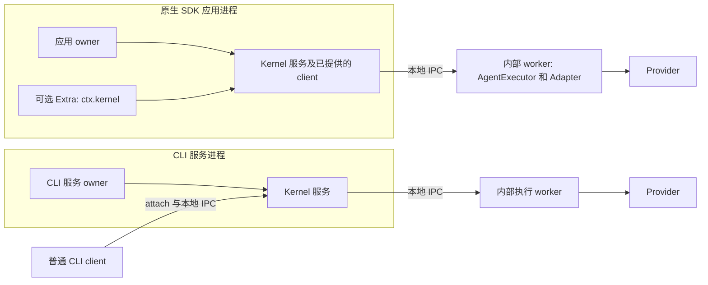
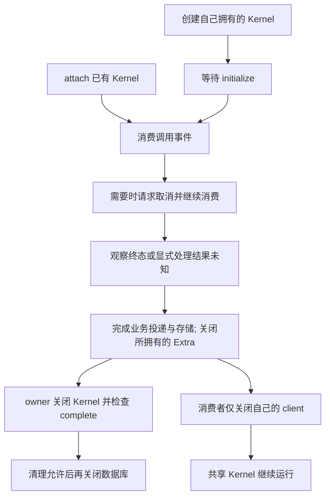

本指南帮助你判断谁启动 Octo Runtime 服务，谁只消费服务。内容固定在正式发布的
**Runtime v1.1.9** [`58332b3bcf56`](https://github.com/Mininglamp-OSS/octo-runtime/blob/58332b3bcf5651f58e674fa236184dc6a0d927ca/docs/zh-CN/getting-started/sdk.md)。
选择 create 或 attach 的依据是**服务所有权**，不是宿主类型本身。
旧版基线与迁移说明保留在 [SDK 参考](/zh/reference/sdks)。

## 装配前先认识 API

下列函数返回实现接口的对象；`KernelService`、`KernelClient` 不是需要 `new` 的类。
`AgentExecutor` 才是具体的底层类。

| API | 返回值与所有者 | 前提和下一步 |
|---|---|---|
| `createKernelService(options)` | 函数返回 `KernelService`，由调用应用拥有。 | 提供监听 `endpoint` 和绝对 JavaScript `workerEntrypoint`；构造不代表就绪。 |
| `KernelService.initialize()` / `status()` | 异步初始化与服务状态快照。 | 等待初始化后才能取 `kernel.client`；状态不证明 Provider 或业务投递验收通过。 |
| `KernelService.client` / `close()` | 已提供的 `KernelClient`；异步 close 返回 `ServiceCleanupResult`。 | 通常直接用该 client，不为执行任务重复 attach；owner 检查 `complete`、错误和待清理资源。 |
| `attachKernel({ endpoint })` | 函数返回按需连接的 `KernelClient`。 | Kernel 已在宿主给定的 endpoint 可用，并满足 OS 账号前提；attach 不启动服务。 |
| `KernelClient.invoke(input, environment?)` | 异步事件迭代器，消费时才提交。 | 提供合法输入并读到终态；`break` 仅停止观察。 |
| `cancelInvocation(invocationId, reason?)` / `respondInteraction(invocationId, response)` | 操作本 client 已登记的调用及匹配交互。 | 保留调用/交互身份；取消受理不是终态或清理完成。Native 模式使用 `respondNativeInteraction`。 |
| `KernelClient.close()` | 同步释放本 client 的连接。 | 不停止共享服务，也不隐式取消已受理 Run。 |
| `serveWorker(adapters, options?)` | worker 入口函数，返回 void，创建 `AgentExecutor` 并注册传入的 Adapter。 | 单独编译/打包入口；Kernel 监督 worker，注册不安装或认证 Provider。 |
| `createExtraService(options)` | 函数返回 `ExtraService` 生命周期接口。 | 提供 endpoint、插件模块、JSON 配置和依赖，再初始化；插件 `ExtraContext` 提供 `ctx.kernel`，Extra 借用而不拥有 Kernel。 |

参见固定版本[服务生命周期](https://github.com/Mininglamp-OSS/octo-runtime/blob/58332b3bcf5651f58e674fa236184dc6a0d927ca/packages/octo-runtime-executor-kernel/src/lifecycle.ts)、
[客户端接口](https://github.com/Mininglamp-OSS/octo-runtime/blob/58332b3bcf5651f58e674fa236184dc6a0d927ca/packages/octo-runtime-executor-kernel/src/types.ts)
及 [Extra 契约](https://github.com/Mininglamp-OSS/octo-runtime/blob/58332b3bcf5651f58e674fa236184dc6a0d927ca/packages/octo-runtime-host-sdk/src/extras.ts)。

### 选择正确的 import 入口

发行包固定为 `@mininglamp-oss/octo-runtime@1.1.9`。源码集成固定对应 commit，
构建选中的 workspace 包；workspace 包名不是根发行包的额外 npm subpath。

| 用途 | 发行包 import | 源码/workspace import |
|---|---|---|
| 服务装配 | `@mininglamp-oss/octo-runtime/host` | `createKernelService` 来自 `@mininglamp-oss/octo-runtime-executor-kernel`；`createExtraService` 来自 `@mininglamp-oss/octo-runtime-host-sdk` |
| client、worker 与类型 | `@mininglamp-oss/octo-runtime/executor-kernel` | `@mininglamp-oss/octo-runtime-executor-kernel` |
| `AgentExecutor` 类 | `@mininglamp-oss/octo-runtime/executor-core` | `@mininglamp-oss/octo-runtime-executor-core` |
| `ExtraContext` 与插件类型 | `@mininglamp-oss/octo-runtime/extra` | `@mininglamp-oss/octo-runtime-host-sdk/extra` |

这些入口以[包导出](https://github.com/Mininglamp-OSS/octo-runtime/blob/58332b3bcf5651f58e674fa236184dc6a0d927ca/package.json)、[host facade](https://github.com/Mininglamp-OSS/octo-runtime/blob/58332b3bcf5651f58e674fa236184dc6a0d927ca/public/host.ts)
和 [Kernel facade](https://github.com/Mininglamp-OSS/octo-runtime/blob/58332b3bcf5651f58e674fa236184dc6a0d927ca/public/executor-kernel.ts) 为准。
直接使用 `AgentExecutor` 是另一条显式底层路径：调用者自行注册 Adapter，在自身进程拥有执行与关闭，
除非自行提供隔离；不会自动获得 Kernel 的 IPC/worker 监督。产品集成优先使用 `KernelClient`，
底层细节见 [Core 实现](https://github.com/Mininglamp-OSS/octo-runtime/blob/58332b3bcf5651f58e674fa236184dc6a0d927ca/packages/octo-runtime-executor-core/src/index.ts)。

## 按服务所有权选择

| 场景 | 选择 | 谁初始化与关闭 |
|---|---|---|
| 应用拥有 Kernel，包括 Electron 主进程 | `createKernelService` 后使用 `kernel.client`。 | 应用装配入口等待 `initialize()`，并检查所拥有服务的清理结果。 |
| 应用消费已有 Kernel | 注入宿主已有 client，或 `attachKernel({ endpoint })`。 | 服务 owner 管 Kernel；调用者只关闭自己拥有的 client。 |
| 内置 Runtime CLI 托管服务 | CLI 服务入口在其服务进程中调用同一 SDK factory。 | CLI/服务管理器拥有注册、进程和自启动；SDK factory 不注册 OS 服务。 |
| 普通 Runtime CLI 客户端命令 | attach 已有 endpoint，例如查询 Adapter 列表。 | 命令关闭 client，不停止 Kernel。 |

这里 Runtime CLI 指 `octo-runtime`，不同于业务 REST 客户端 `octo-cli`。
Gateway 与 Kernel 服务仍各自独立拥有生命周期。参见固定版本
[CLI 装配](https://github.com/Mininglamp-OSS/octo-runtime/blob/58332b3bcf5651f58e674fa236184dc6a0d927ca/apps/cli/src/main.ts)及[集成合同](https://github.com/Mininglamp-OSS/octo-runtime/blob/58332b3bcf5651f58e674fa236184dc6a0d927ca/INTEGRATION.md)。

图示表达进程和所有权，不保证 OS 沙箱。Electron 在 main process 原生构造服务，
通过应用自己的可信边界向业务模块提供 client；将内部 JavaScript worker、所选 Adapter 和依赖纳入构建。
不要把 Runtime CLI 或外部 Node launcher 当作顶层 SDK 服务接入。
仅 attach 的消费者则需要已有受管理、可访问的 endpoint，以及负责其生命周期的 owner；
Electron 本身不会把任意 endpoint 变成自己拥有的服务。

## 将生命周期延续到清理完成

退出时停止接纳新任务，需要时使用 client 的 invocation lifecycle。
取消 ACK、执行终态、调用排空、服务清理与业务投递完成是不同事实。
关闭自己拥有的 Kernel 和数据库前，先关闭 Extra 并完成其投递/存储收尾。
检查 `close().complete`；清理不完整时保留并处理待清理资源，不能宣称关闭成功。
attached client 不因等待 Run 而获得服务所有权。参见
[关闭合同](https://github.com/Mininglamp-OSS/octo-runtime/blob/58332b3bcf5651f58e674fa236184dc6a0d927ca/packages/octo-runtime-executor-kernel/src/types.ts)
及[服务示例](https://github.com/Mininglamp-OSS/octo-runtime/blob/58332b3bcf5651f58e674fa236184dc6a0d927ca/docs/examples/service.mts)。

## 继续阅读官方 Node 示例

这些 Node 示例需要 Node.js 24.x 或 26.x，另行安装并认证所选 Provider。
下载同一版本的原始文件，保留其 helper import，并使用上述固定发行包：
- [attach 示例](https://github.com/Mininglamp-OSS/octo-runtime/blob/58332b3bcf5651f58e674fa236184dc6a0d927ca/docs/examples/attach.mts)和 [invoke helper](https://github.com/Mininglamp-OSS/octo-runtime/blob/58332b3bcf5651f58e674fa236184dc6a0d927ca/docs/examples/invoke.mts)：
  需要运行中的 Kernel、真实 endpoint，以及在执行机器上安装并认证的 Provider。
  示例消费事件、取消需答复的交互、报告执行失败，最后关闭 client，保留 Kernel 运行。
- [服务所有权 helper](https://github.com/Mininglamp-OSS/octo-runtime/blob/58332b3bcf5651f58e674fa236184dc6a0d927ca/docs/examples/service.mts)和完整的
  [Node SDK quickstart](https://github.com/Mininglamp-OSS/octo-runtime/blob/58332b3bcf5651f58e674fa236184dc6a0d927ca/docs/zh-CN/getting-started/sdk.md)：提供 endpoint 和编译后的 worker，
  等待初始化、消费终态、必要时取消并检查清理。链接中的 DSH 示例另需其文档所述安装与 `DSH_BIN`，
  明确使用 `full_access`，不是通用 Electron 权限模板。

已发布 quickstart 已正确使用 `attachKernel({ endpoint })`。这些是 Node 示例，不是 Electron
打包配方或 Electron 原生验证证据。请在目标 Electron 环境验收 worker 路径、依赖打包、启动和清理。
配置、凭据、会话持久化和数据库仍由宿主负责。
版本/交互兼容性见 [SDK 参考](/zh/reference/sdks)，部署生命周期见[升级说明](/zh/guides/operators/upgrades)；
本指南不代表审批或生产验收。
