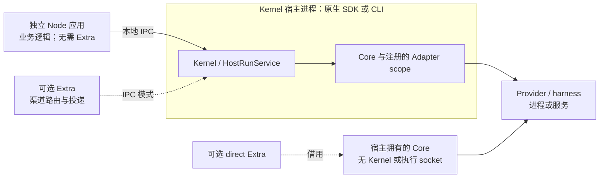

你的 Node.js 应用可以调用已有本地 Executor Kernel，**不必编写或启动 Extra**。安装独立客户端，使用 Kernel 所有者提供的端点即可。应用负责业务身份认证、权限、输入与上下文构造、事件处理、会话持久化、交互界面和结果投递。

本指南适用于 2026-11-05 发布的[正式 Runtime v1.1.11](https://github.com/Mininglamp-OSS/octo-runtime/releases/tag/v1.1.11)，固定提交为 [`780cd7cd5e67`](https://github.com/Mininglamp-OSS/octo-runtime/tree/780cd7cd5e67e4868df895a2e74a826097f349fd)。它不描述草稿版本或实际部署状态。[v1.1.9 接入概览](/zh/guides/integrators/runtime-sdk-orientation)和 [v1.1.10 迁移指南](/zh/guides/integrators/runtime-v1110-migration)保留各自版本的适用范围。

<Warning>
  **不要只改依赖版本就继续运行本页示例。** 已正式发布的 Runtime v1.1.12、v1.1.13 和 v1.1.14 虽然是补丁版本号，却包含破坏性变更。先核对下方对应版本的迁移说明。下方示例和接入方式表保留为 **1.1.11** 的历史指南。
</Warning>

## 升级到 v1.1.13 之前

[v1.1.13](https://github.com/Mininglamp-OSS/octo-runtime/releases/tag/v1.1.13) 于 2026-11-10 正式发布，标签对应 [`7892ebdf2ed9`](https://github.com/Mininglamp-OSS/octo-runtime/tree/7892ebdf2ed9b1fa859bd51f15da6d7f03c247e2)。使用 **Runtime 1.1.13 与 client 1.1.13** 发行组合。下文 1.1.12 的四参数调用与服务迁移要求仍然适用。以下变更在 **1.1.13** 已生效，依据该版[输入合同](https://github.com/Mininglamp-OSS/octo-runtime/blob/7892ebdf2ed9b1fa859bd51f15da6d7f03c247e2/docs/en/reference/invoke-input.md)、[执行信封](https://github.com/Mininglamp-OSS/octo-runtime/blob/7892ebdf2ed9b1fa859bd51f15da6d7f03c247e2/docs/en/reference/contexts.md)、[原生 SDK](https://github.com/Mininglamp-OSS/octo-runtime/blob/7892ebdf2ed9b1fa859bd51f15da6d7f03c247e2/docs/en/getting-started/sdk.md)与 [Codex 所有权合同](https://github.com/Mininglamp-OSS/octo-runtime/blob/7892ebdf2ed9b1fa859bd51f15da6d7f03c247e2/packages/octo-runtime-adapter-codex/README.md)：

| 边界 | 必需迁移 |
| --- | --- |
| 本地工作目录 | 自行准备已获授权、存在的绝对目录。`octo.execution/workspace` 只使用 `payload: { path: "/absolute/prepared/project" }`。移除 `mode`，包括 `fixed`、`random` 和 `none`；带旧 mode 的 payload 会被拒绝。Runtime 不选择、创建或补建目录。声明 `metadata.workspace: false` 的 Adapter 可以省略本地覆盖。路径校验不是沙箱或资源授权。 |
| 应用提示词 | 移除 `octo.control/instructions` 和 `controlInstructions`，即使为空也会被拒绝。将提示词准备成普通输入 parts，续接或显式恢复时也由调用方提供完整内容。没有替代的 system/developer/trusted 提示词字段。 |
| 原生宿主装配 | 构造命令型 Adapter 时绑定明确的绝对可执行文件路径。Codex 可通过 `createManagedCodexEngine` 和绝对 `codexHome` 创建 managed owner，也可注入既有 `CodexEngineProvider`。宿主负责最终清理，Adapter 借用 Engine provider。仅关闭借用它的 Core/Kernel 不会自动关闭 owner。原生嵌入使用选定的源码 workspace 包；完整 npm 包不再导出 `/adapters/codex` 或 `/adapters/dsh`。独立客户端应用仍只需 client 包。 |

`agentEnv` 在 1.1.13 已只允许 `schema` 和 `items`；移除旧的顶层执行字段，使用该版共享或 Adapter 自有条目。

1.1.13 仍定义 `octo.execution/actmode`，尚无下节的 `model_output_idle` 通知。不要把 1.1.14 的控制项移除或新通知要求套用到 1.1.13。

## 升级到 v1.1.14 之前

[v1.1.14](https://github.com/Mininglamp-OSS/octo-runtime/releases/tag/v1.1.14) 于 2026-11-10 正式发布，标签对应 [`c9d3bb6a642a`](https://github.com/Mininglamp-OSS/octo-runtime/tree/c9d3bb6a642abce3177ac28cf9f26993909c3d32)。配对 **Runtime 1.1.14 与 client 1.1.14**，同时迁移应用。IPC v2 / Run 7 / Context v3 编号未变，不代表旧字段或事件校验器仍然兼容。

除上文 1.1.13 的准备要求外，**1.1.14** 还需按该版[执行信封](https://github.com/Mininglamp-OSS/octo-runtime/blob/c9d3bb6a642abce3177ac28cf9f26993909c3d32/docs/en/reference/contexts.md)与[输入合同](https://github.com/Mininglamp-OSS/octo-runtime/blob/c9d3bb6a642abce3177ac28cf9f26993909c3d32/docs/en/reference/invoke-input.md)检查以下边界：

| 边界 | 必需迁移 |
| --- | --- |
| 信封与模型字段 | `agentEnv` 继续只允许 `schema` / `items`。1.1.14 移除 item 的 `guidance` / `data_format`，每个 item 只保留 `namespace` / `name` / `payload`，并移除 `use_provider_default`。空的 model/selection/reasoning 对象在 1.1.13 已不合法；继续省略不需要的覆盖项。省略不会清除已组合的默认值，也不会重置续接中的 Provider 会话。 |
| 已移除控制项 | 公共 source 分类、actmode、`execution.update` 与 Runtime 设备选择的公共协议定义已移除。旧 source/actmode item 可能通过通用不透明信封校验，但不生效，也不会兼容转换。attach 前先选定设备；原生模式只使用所选 Adapter 文档中的私有选项，与审批策略分开。移除 `limits.enforcement`，Adapter 读取 limits 时会拒绝它。使用有限预算，不再全局关闭 watchdog。 |

**升级服务时同步事件消费者。** v1.1.14 在 canonical 模式下增加信息性 `run.notice`，当连续 60 秒没有新增公开模型文本时发出 `code: "model_output_idle"`。排队、工具执行、同步输入/审批等待会暂停观察，新增公开文本开启下一段计时。它不是终态、取消请求或周期性保活；默认首帧超时可能先失败。`model_idle_policy: "observe"` 只关闭模型空闲终止，不关闭其他预算。即使 IPC 仍为 v2，旧严格校验器也会拒绝新 notice code。以固定[输出/控制合同](https://github.com/Mininglamp-OSS/octo-runtime/blob/c9d3bb6a642abce3177ac28cf9f26993909c3d32/docs/en/reference/output-and-control.md)和[通知实现](https://github.com/Mininglamp-OSS/octo-runtime/blob/c9d3bb6a642abce3177ac28cf9f26993909c3d32/packages/octo-runtime-executor-core/src/model-output-silence.ts)为准，不凭协议编号相同推断投递成功或兼容性。

新客户端使用 [v1.1.14 客户端参考](https://github.com/Mininglamp-OSS/octo-runtime/blob/c9d3bb6a642abce3177ac28cf9f26993909c3d32/packages/octo-runtime-client/README.md)，嵌入式宿主使用 [Codex 所有权合同](https://github.com/Mininglamp-OSS/octo-runtime/blob/c9d3bb6a642abce3177ac28cf9f26993909c3d32/packages/octo-runtime-adapter-codex/README.md)。下方 1.1.11 示例不是 v1.1.14 迁移配方。本节已核对源码；此次更新未执行真实 Provider、Gateway/IM、Windows 服务或部署迁移。

## 升级到 v1.1.12 之前

v1.1.12 标签对应提交 [`4276f6d33946`](https://github.com/Mininglamp-OSS/octo-runtime/tree/4276f6d339461daa88c3215b8024d548eb313cb1)。使用匹配的 **Runtime 1.1.12 与 client 1.1.12** 发行组合。npm 包版本、IPC v2、Run 7 和 Context v3 是不同合同；IPC v2 **不代表**必须寻找 npm 2.x 包。

| 边界 | 与本页 1.1.11 指南的差异 |
|---|---|
| 调用接口 | [公开客户端](https://github.com/Mininglamp-OSS/octo-runtime/blob/4276f6d339461daa88c3215b8024d548eb313cb1/packages/octo-runtime-client/src/types.ts) 使用 `invoke(inputs, sessionId, providerSession, agentEnv)`。下方旧的单请求对象会被拒绝。按发行版类型重新构造调用，不要把旧对象原样放进第一个参数。 |
| 执行与控制 | 执行配置放在 `agentEnv`，与业务输入及会话参数分开。对已登记调用使用 `interrupt(invocationId, reason?)`；取消被受理不等于执行已终止。输入结构合法也不代表获得资源权限。 |
| 传输 | [客户端在提交前检查 IPC v2](https://github.com/Mininglamp-OSS/octo-runtime/blob/4276f6d339461daa88c3215b8024d548eb313cb1/packages/octo-runtime-client/src/client.ts)，拒绝不支持的版本。只升级一端不属于支持的迁移组合；不存在自动降级或自动重放执行。 |
| 渠道接入 | [Runtime 不再加载 Extra 插件](https://github.com/Mininglamp-OSS/octo-runtime/blob/4276f6d339461daa88c3215b8024d548eb313cb1/README.md)。Extra、内置 WebUI 和 WeCom 已从此发行包移除。渠道职责转到独立 Gateway；下方 Extra 接入行不适用于 1.1.12。 |
| CLI 与已安装服务 | `octo-runtime executor-kernel <command>` 已移除，没有兼容别名。使用 `octo-runtime start` 等顶层生命周期命令。已有服务定义也需要刷新，不能只替换可执行文件。 |

修改已安装服务前，先完成或明确核对未结束的工作，并保留 Home 与配置。按固定的 [v1.1.12 CLI 迁移说明](https://github.com/Mininglamp-OSS/octo-runtime/blob/4276f6d339461daa88c3215b8024d548eb313cb1/docs/zh-CN/getting-started/cli.md)，使用相同 `--home`，以及原先显式使用的 `--profile`/`--manifest`，依次 stop、install、start。`install` 默认开启自启；需要保持禁用时传 `--autostart=false`。安装包成功不证明部署成功。

新客户端请从[发行版客户端参考](https://github.com/Mininglamp-OSS/octo-runtime/blob/4276f6d339461daa88c3215b8024d548eb313cb1/packages/octo-runtime-client/README.md)及其公开类型开始，不要零散修补下方历史示例。在自己的环境中核验版本配对、输入构造、交互、取消、重连和退出行为。本地 IPC 仍沿用现有操作系统账号的信任边界。

## 采用 Gateway v1.0.1 之前

**Gateway 有独立的发布与迁移边界。** [Gateway v1.0.1](https://github.com/Mininglamp-OSS/octo-channel-gateway/releases/tag/v1.0.1) 已于 2026-11-11 正式发布，固定提交为 [`7af029872a6f`](https://github.com/Mininglamp-OSS/octo-channel-gateway/tree/7af029872a6fa8914033a6f2138e3d4b10a5ecc3)，包含已合并的 [PR #35](https://github.com/Mininglamp-OSS/octo-channel-gateway/pull/35)。其[生产客户端与开发 Runtime 依赖](https://github.com/Mininglamp-OSS/octo-channel-gateway/blob/7af029872a6fa8914033a6f2138e3d4b10a5ecc3/package.json#L44-L52)均为 `^1.1.14`。按上文对应的 Runtime/client 合同迁移；1.1.12 发行组合和下方历史 Extra 配置都不是 Gateway 1.0.1 接入配方。

- **迁移注册接口。** 使用 `gateway.register(bot, agent, hooks)`，显式提供 `botId`；Hook 数组可选。启用的绑定必须匹配认证后的 Bot 身份。已移除的 `materials` / `loadMaterials` 注册字段会被拒绝，没有兼容层。参见[注册校验](https://github.com/Mininglamp-OSS/octo-channel-gateway/blob/7af029872a6fa8914033a6f2138e3d4b10a5ecc3/packages/gateway/src/gateway.ts#L78-L170)。
- **自行管理应用策略。** `pre_dispatch` 和 `pre_invoke` Hook 按序执行，返回完整的 `{ inputs, agentEnv }` 替换值；身份/路由变更和冻结重试内容的变更会被拒绝。[首轮指令注入与完整请求调试日志](https://github.com/Mininglamp-OSS/octo-channel-gateway/blob/7af029872a6fa8914033a6f2138e3d4b10a5ecc3/apps/cli/src/hooks.ts#L5-L43)由 CLI 安装的 Hook 提供，不是 SDK 自动执行的策略。SDK/Electron 宿主需自行提供策略。调试日志包含实际输入、图片数据和执行设置，启用前应检查敏感内容及日志访问范围。参见[Hook 合同](https://github.com/Mininglamp-OSS/octo-channel-gateway/blob/7af029872a6fa8914033a6f2138e3d4b10a5ecc3/packages/gateway/src/hooks.ts#L6-L79)。
- **单独核对超时迁移。** 截至 2026-11-12，[Gateway issue #34](https://github.com/Mininglamp-OSS/octo-channel-gateway/issues/34) 仍开放。v1.0.1 保留[每 30 秒更新的本地静默计时和本地观察到模型连续静默 300 秒后的超时](https://github.com/Mininglamp-OSS/octo-channel-gateway/blob/7af029872a6fa8914033a6f2138e3d4b10a5ecc3/packages/gateway/src/execution/model-wait.ts#L165-L185)，并接到[请求取消逻辑](https://github.com/Mininglamp-OSS/octo-channel-gateway/blob/7af029872a6fa8914033a6f2138e3d4b10a5ecc3/packages/gateway/src/execution/task.ts#L93-L99)。它还默认设置 [310 秒首帧预算和 `model_idle_policy: "observe"`](https://github.com/Mininglamp-OSS/octo-channel-gateway/blob/7af029872a6fa8914033a6f2138e3d4b10a5ecc3/packages/gateway/src/execution/dispatcher.ts#L118-L127)。Runtime 的信息性 `model_output_idle` 通知不表示 Gateway 已完成改用上游静默事实的迁移。请求取消不等于执行终止。

不要原样复制旧 Extra 配置，也不要凭正式发布或依赖范围推断部署已就绪。本次更新核对了发行元数据与固定源码合同，未核验 npm 发布、未检查或运行 Gateway 发行归档，也未执行真实 Provider/IM、Windows 服务或部署迁移测试。

## 按所有权选择接入方式

以下包入口全部适用于 **1.1.11**。表中的短子路径属于 `@mininglamp-oss/octo-runtime`。

| 接入方式 | 安装包与公开入口 | 是否需要 Kernel / Extra？ | 所有权与适用场景 |
|---|---|---|---|
| 独立客户端 | `@mininglamp-oss/octo-runtime-client` 根入口 `attachKernel({ endpoint })`；类型与校验来自 `/protocol` | 已有 Kernel；不需要 Extra | 服务所有者启停 Kernel。独立 Node 应用负责业务接入、自己的调用和连接。适合消费已经托管的执行能力。 |
| 原生 Kernel 宿主 | 完整 Runtime；`/executor-kernel` 或 `/host` 的 `createKernelService`；`/host` 的 `componentEndpoint` | 创建 Kernel；Extra 可选 | 宿主提供已准备的 Home 和实际 Adapter 对象，等待 `initialize()` 后使用 `kernel.client`，最后关闭自己拥有的服务。适合产品需要掌握执行生命周期。 |
| 直接使用 Core | 完整 Runtime；`/executor-core` 的 `AgentExecutor`；`/adapters/codex` 的 `createCodexAdapter` | 两者都不需要 | 宿主注册 Adapter、消费 `executor.invoke`、负责业务并等待 `executor.shutdown()`。适合明确选择进程内嵌入、不需要 Kernel 接纳管理、IPC 或重连的场景。 |
| Extra 接入 | 完整 Runtime；`/host` 的 `createExtraService`；例如 `/extras/channel-gateway` 模块 | IPC 模式需要已有 Kernel；direct 模式借用 Core。只有选择此方式才需要 Extra | 宿主管理插件生命周期与配置；插件负责渠道认证、路由、调用和投递。适合把这些职责封装成可复用插件。关闭 Extra 不会关闭共享 Core/Kernel。 |
| CLI 部署 | 完整 Runtime；`octo-runtime` 可执行程序，例如 `executor-kernel run` 或 `start` | 托管 Kernel；Extra 分别可选 | CLI/服务管理器负责部署和生命周期。独立客户端可以消费该 Kernel，无需把 CLI 当业务 API。`start` 可能安装组件并开启自启；请按固定版本的 [CLI 指南](https://github.com/Mininglamp-OSS/octo-runtime/blob/780cd7cd5e67e4868df895a2e74a826097f349fd/docs/zh-CN/getting-started/cli.md)明确选择。 |

这些选择可以组合：原生 SDK 宿主或 CLI 都能为独立客户端提供 Kernel，两者都不要求 Extra。Runtime CLI（`octo-runtime`）与业务 API 工具 `octo-cli` 是不同程序。Electron/Tauri 产品使用 SDK 接入，不把 CLI 启动或终端输出解析当作业务接入层。Electron 在主进程装配；浏览器/renderer 不直接使用此 Node 客户端。本指南不提供或验证 Tauri 桥接和 Electron 打包方案。



自 v1.1.10 起，**执行 worker 和 `serveWorker` 已移除**。Kernel、Core 与注入的 Adapter 对象共享宿主进程和故障域；本地 RPC 不能隔离阻塞、进程退出或内存耗尽。Provider 子进程属于 Adapter 的另一项职责。

## 准备已有服务

使用 **Node.js 24 或 26**，将客户端 **1.1.11** 与 Runtime **1.1.11** 配对。客户端发行包包含共享协议，不包含 CLI、服务端、Core、Provider Adapter 或 Extra。安装客户端或调用 `attachKernel` 不会初始化 Home、安装/认证 Provider、启动 Kernel 或创建 Extra。

调用前，请让服务所有者确认：

1. Kernel 已运行且已注册所需 Adapter。示例选择 Codex，其 harness 必须已在 **Kernel 宿主环境**中安装并完成认证。注册成功或 `status()` 查询成功，不证明 Provider 已就绪或账号有模型权限。
2. 提供的端点是该 Kernel 的本地 Unix socket 或 Windows named pipe。POSIX v1.1.11 使用 `<home>/executor-kernel.sock`；不要传 Home 目录、Extra 控制 socket 或 URL。Windows 应直接取得宿主派生的管道名，不要拼 POSIX 路径。
3. 所选工作目录存在、调用者获准使用，且 Provider 可以访问。工作目录、Context JSON 校验和“不使用工具”的提示词都不是沙箱或授权控制。

本地 IPC 沿用操作系统账号的信任边界。独立进程不意味着远程认证、HTTP/WebSocket 传输、浏览器执行或跨设备路由。应用必须先授权入站用户和资源访问，再构造可信的执行/安全 Context；不要把不可信的策略或环境设置直接复制到调用中。

## 运行完整的外部 Node 示例

在新的应用目录安装固定客户端版本。以下是读者的准备命令；安装客户端不会启动服务。

```bash
npm init -y
npm install --save-exact @mininglamp-oss/octo-runtime-client@1.1.11
```

将以下内容保存为 `main.mts`。Node 24/26 可以直接运行这份 TypeScript。它提供具体文本输入、Context v3、Codex 选择、固定工作目录、`ask` 审批和 60 秒执行预算。示例创建全新业务会话，不演示持久化或 Provider 会话续接。

```typescript
import { randomUUID } from "node:crypto";
import { stat } from "node:fs/promises";
import { isAbsolute } from "node:path";
import { attachKernel, KernelError } from "@mininglamp-oss/octo-runtime-client";
import { InvokeInput } from "@mininglamp-oss/octo-runtime-client/protocol";

const workdir = process.env.WORKDIR;
if (!workdir || !isAbsolute(workdir) || !(await stat(workdir)).isDirectory())
  throw new Error("WORKDIR must be an existing absolute directory");

const input = {
  invocationId: randomUUID(),
  sessionId: randomUUID(),
  runId: randomUUID(),
  protocol_mode: "canonical" as const,
  inputs: [{ type: "text" as const, text: "Reply with hello. Do not use tools." }],
  contexts: {
    schema: "octo.context-envelope/v3" as const,
    items: [
      { namespace: "octo.execution", name: "adapter", payload: { type: "codex" } },
      { namespace: "octo.execution", name: "workspace", payload: { mode: "fixed", path: workdir } },
      { namespace: "octo.security", name: "approval_policy", payload: { mode: "ask" } },
      { namespace: "octo.execution", name: "limits", payload: { run_timeout_ms: 60000 } }
    ]
  }
} satisfies InvokeInput;
InvokeInput.check(input);

if (process.argv.includes("--check-input")) {
  console.log("Input structure valid; no Kernel connection or Provider call made.");
} else {
  const endpoint = process.env.KERNEL_ENDPOINT;
  if (!endpoint) throw new Error("KERNEL_ENDPOINT must be supplied by the Kernel owner");
  const client = attachKernel({ endpoint });
  let terminal: string | undefined;
  let stopping: Promise<void> | undefined;
  let cancellationRequested = false;
  const stop = () => stopping ??= (async () => {
    client.invocations.stopAdmission();
    try {
      const result = await client.invocations.drain({
        deadline: Date.now() + 5000, reason: "standalone application exit"
      });
      if (!result.complete) {
        console.error("Unresolved invocations; preserve these identities for investigation:", result.unresolved);
        process.exitCode = 1;
      }
    } finally {
      client.close();
    }
  })();
  const onStop = () => { void stop().catch(() => { process.exitCode = 1; }); };
  process.once("SIGINT", onStop);
  process.once("SIGTERM", onStop);
  const timer = setTimeout(onStop, 65000);
  try {
    for await (const event of client.invoke(input)) {
      if (event.type === "message.delta" && typeof event.payload.text === "string")
        process.stdout.write(event.payload.text);
      if (event.type === "interaction.requested" && event.payload.delivery !== "async" &&
          event.payload.responseRequired !== false && !cancellationRequested) {
        cancellationRequested = true;
        try {
          await client.cancelInvocation(input.invocationId, "example has no interaction UI");
        } catch (error) {
          console.error(error instanceof KernelError ? error.code : "CANCEL_FAILED");
          process.exitCode = 1;
        }
      }
      if (["run.completed", "run.failed", "run.cancelled"].includes(event.type)) {
        terminal = event.type;
        console.error("Execution terminal:", terminal);
      }
    }
    if (terminal !== "run.completed") process.exitCode = 1;
  } catch (error) {
    console.error(error instanceof KernelError ? error.code : "INVOCATION_FAILED");
    process.exitCode = 1;
  } finally {
    clearTimeout(timer);
    process.off("SIGINT", onStop);
    process.off("SIGTERM", onStop);
    await stop();
  }
}
```

先只在本地校验输入。把 `WORKDIR` 设为你授权使用的既有目录；示例路径仅作说明。`--check-input` 不连接 Kernel。

```bash
export WORKDIR="/absolute/authorized/project"
node main.mts --check-input
```

真实调用还需从服务所有者取得 `KERNEL_ENDPOINT`，再不带该标志运行文件。这会调用配置好的 Provider，可能产生用量或工具副作用；文本提示词不是安全策略。以下 POSIX 示例假定宿主的 Home 是 `/absolute/runtime-home`；Windows 请在所用 shell 中设置宿主提供的命名管道。

```bash
export KERNEL_ENDPOINT="/absolute/runtime-home/executor-kernel.sock"
node main.mts
```

只有 `run.completed` 表示执行成功。失败或取消终态会设置非零退出状态；执行失败可能只通过 `run.failed` 事件到达而不抛异常。canonical `invoke` 直接返回 `CanonicalEvent`，不是 `HostFrame.event`。文本输出只是示例展示，不是持久化结果的投递回执。

示例没有交互界面，因此只取消首次需要外部答复的同步交互，并继续观察。省略 `payload.responseRequired` 表示需要答复。示例忽略标记为 `payload.delivery === "async"` 的可选问题，以及标记为 `payload.responseRequired === false`、由 Adapter 负责的自动审批。后一个标记不证明审批已投递、交互已解决或执行已完成。示例本身不会回答或授予批准。真实产品应实现自己的交互和投递合同，具体字段见固定版本的[交互类型合同](https://github.com/Mininglamp-OSS/octo-runtime/blob/780cd7cd5e67e4868df895a2e74a826097f349fd/packages/octo-runtime-protocol/src/generated/protocol-types.ts)。

收到 SIGINT/SIGTERM 或达到 65 秒应用计时器后，示例停止接纳，按五秒绝对截止时间取消并排空本客户端登记的调用，再关闭连接。正常完成也检查排空结果。排空不完整时保留原身份报告，不自动重新提交调用。在长期运行产品中使用此模式前，应把未解决记录保存到自己的持久事件/会话存储；这个控制台示例不提供崩溃恢复或持久存储。

如需静态检查，使用已审核的 TypeScript 编译器及 Node 24 类型，运行参数为 `--strict --noEmit --module NodeNext --moduleResolution NodeNext --target ES2022 main.mts`。交互条件修正前的示例使用官方客户端归档、TypeScript 5.9.3、Node 类型 24.13.5 和 Node 24.22.1，通过了严格类型检查及纯 `--check-input` 路径。本次修正核对了固定版本协议，并从英中示例提取事件处理代码，以合成事件完成回归；本轮未重跑完整类型检查和 `--check-input` 路径。**未执行真实 Kernel/Provider 调用、Windows 运行、Electron/Tauri 打包、认证或部署验收。**

## 处理结果，只关闭自己拥有的资源

`invoke` 在开始消费时提交，负责有界的调用登记与观察恢复。`submit`/`subscribe` 是高级 API，调用者自行管理 Run 引用、取消和观察。提交 ACK 丢失时按原身份查询。恢复有界，不是持久历史；执行结果未知或发生重启后，不要自动重新提交执行。

取消 ACK、执行终态、资源清理和业务持久化/投递是不同事实。中断迭代或调用 `client.close()` 只停止观察/连接，不会停止已受理工作或共享 Kernel。`invocations.drain({ deadline, reason })` 请求取消并查询登记调用，直到 `Date.now()` 表示的绝对截止时间；`complete` 只描述该登记表，不代表 Provider 进程清理或业务投递完成。v1.1.11 允许用户新的显式 Stop 在失败/结果未知后重试取消；signal/drain 不会盲目重发结果未知的控制动作。保留 `RUN_OUTCOME_UNKNOWN`、`OPERATION_OUTCOME_UNKNOWN` 等错误供排查。

产品所有者先停止新工作、排空自己的调用，在退出预算内完成业务消费者及持久化/投递，再关闭客户端。附着客户端永不关闭共享 Kernel。原生服务所有者还需先关闭自己的 Extra，再关闭 Kernel，并检查每次等待服务关闭后的 `complete`；direct Core 所有者等待 `shutdown()` 并检查 `cleanup`。裸 `AgentExecutor.invoke` 的迭代提前结束会请求取消；Extra direct scope 则拥有独立观察，停止观察不取消已受理工作。

Codex Adapter 注册的 **Core scope（Core 管理的服务作用域）**拥有兼容配置下的常驻 app-server 进程。正常完成、取消和 Extra 关闭只释放调用，不终止共享 app-server。只有 Core/Kernel 所有者关闭该服务作用域。Provider 服务的有界恢复不会重放原业务/控制请求，也不是崩溃应用宿主的自动恢复。请核对固定版本的 [Codex 生命周期与平台限制](https://github.com/Mininglamp-OSS/octo-runtime/blob/780cd7cd5e67e4868df895a2e74a826097f349fd/packages/octo-runtime-adapter-codex/README.md)，特别是 Windows leader/后代进程的限制。

## 将服务宿主与 Extra 迁移到 v1.1.11

- **显式准备 Home。** SDK Kernel 和 IPC Extra 服务要求宿主提供既有绝对目录 `home`；SDK 没有默认 Home，不展开 `~`，不创建根目录或选择备用目录。宿主准备后提供 `home`、`endpoint` 与实际 Adapter 对象。初始化先校验，再创建自身资源。保留启动失败/回滚信息并检查清理；不要为解决路径错误擦除身份/配置。`resolveHostHome(appId)` 已移除；`componentEndpoint(home)` 只派生/校验地址，不证明目录存在。
- **协调端点切换。** 停止旧进程，同步更新 Kernel 及所有 clients/Extras，然后用直接 POSIX 地址 `<home>/executor-kernel.sock` 重启。Windows 管道名和 Extra 控制地址不变。没有新增旧 socket 自动回退或兼容协商。
- **保留现有数据与 CLI 意图。** CLI 使用显式 `--home`，否则选择 `~/.octo-runtime`，并准备根目录。旧环境变量/平台默认位置不再用于选择 Home；使用 `--home` 保留旧位置。既有服务定义保留原先的显式位置。不意味着自动移动数据或重置身份。
- **明确选择 Extra 执行方式。** `createExtraService({ home, execution: { kind: "ipc", endpoint }, module, config, dependencies })` 连接已有 Kernel。`createExtraService({ execution: { kind: "direct", executor }, module, config, dependencies })` 借用同一 Runtime 安装中的 Core，在不需要 Home 资源时可以省略 Home。插件使用 `context.execution`。旧顶层 `{ home, endpoint, ... }` 仍支持，但不能和 `execution` 混用。两种模式关闭 Extra 都只影响自己的调用/资源；共享 Core/Kernel 由宿主关闭。direct 模式不提供 IPC 重连、持久回放或进程隔离。
- **使用本版本的导出。** v1.1.11 新增公开 `/adapters/codex`；v1.1.10 关于该导出不存在的说明保留为历史。完整 Runtime 的 `/executor-kernel` 与 `/protocol` 仍支持。不要把客户端 `/internal` 装配辅助入口当作稳定应用 API。同时安装两个发行物可能产生不同模块副本；使用产生错误的 API 所属错误类或其公开 `code`，不要依赖跨包 `instanceof`。

包版本与 IPC v1、Run 7、Context v3 分别管理。请匹配发行对；不保证任意跨版本互通。`status()` 对不支持的 IPC 报 `KERNEL_IPC_VERSION_UNSUPPORTED`，对畸形状态报 `INVALID_RESPONSE`；提交会在写入调用前做此状态检查。没有版本协商、降级或兼容转换。

## 固定版本的来源合同

以下全部固定至正式提交，不使用变化中的 `main` 或 issue 提案：

- [客户端包与兼容性](https://github.com/Mininglamp-OSS/octo-runtime/blob/780cd7cd5e67e4868df895a2e74a826097f349fd/packages/octo-runtime-client/README.md)、[公开导出](https://github.com/Mininglamp-OSS/octo-runtime/blob/780cd7cd5e67e4868df895a2e74a826097f349fd/package.json)、[客户端类型/所有权](https://github.com/Mininglamp-OSS/octo-runtime/blob/780cd7cd5e67e4868df895a2e74a826097f349fd/packages/octo-runtime-client/src/types.ts)。
- [输入合同](https://github.com/Mininglamp-OSS/octo-runtime/blob/780cd7cd5e67e4868df895a2e74a826097f349fd/docs/zh-CN/reference/invoke-input.md)、[输出/控制](https://github.com/Mininglamp-OSS/octo-runtime/blob/780cd7cd5e67e4868df895a2e74a826097f349fd/docs/zh-CN/reference/output-and-control.md)、[客户端实现](https://github.com/Mininglamp-OSS/octo-runtime/blob/780cd7cd5e67e4868df895a2e74a826097f349fd/packages/octo-runtime-client/src/client.ts)、[调用生命周期](https://github.com/Mininglamp-OSS/octo-runtime/blob/780cd7cd5e67e4868df895a2e74a826097f349fd/packages/octo-runtime-client/src/invocation-lifecycle.ts)。
- [Home 校验与迁移](https://github.com/Mininglamp-OSS/octo-runtime/blob/780cd7cd5e67e4868df895a2e74a826097f349fd/docs/zh-CN/reference/runtime-home.md)、[原生 SDK 与 Extra 模式](https://github.com/Mininglamp-OSS/octo-runtime/blob/780cd7cd5e67e4868df895a2e74a826097f349fd/docs/zh-CN/getting-started/sdk.md)、[Extra 选项/所有权](https://github.com/Mininglamp-OSS/octo-runtime/blob/780cd7cd5e67e4868df895a2e74a826097f349fd/packages/octo-runtime-host-sdk/src/extra-service.ts)。
