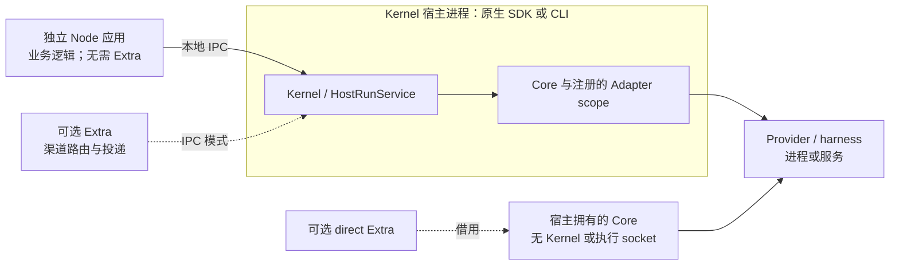

你的 Node.js 应用可以调用已有本地 Executor Kernel，**不必编写或启动 Extra**。安装独立客户端，使用 Kernel 所有者提供的端点即可。应用负责业务身份认证、权限、输入与上下文构造、事件处理、会话持久化、交互界面和结果投递。

本指南适用于 2026-11-05 发布的[正式 Runtime v1.1.11](https://github.com/Mininglamp-OSS/octo-runtime/releases/tag/v1.1.11)，固定提交为 [`780cd7cd5e67`](https://github.com/Mininglamp-OSS/octo-runtime/tree/780cd7cd5e67e4868df895a2e74a826097f349fd)。它不描述草稿版本或实际部署状态。[v1.1.9 接入概览](/zh/guides/integrators/runtime-sdk-orientation)和 [v1.1.10 迁移指南](/zh/guides/integrators/runtime-v1110-migration)保留各自版本的适用范围。

## 按所有权选择接入方式

以下包入口全部适用于 **1.1.11**。表中的短子路径属于 `@mininglamp-oss/octo-runtime`。

| 接入方式 | 安装包与公开入口 | 是否需要 Kernel / Extra？ | 所有权与适用场景 |
|---|---|---|---|
| 独立客户端 | `@mininglamp-oss/octo-runtime-client` 根入口 `attachKernel({ endpoint })`；类型与校验来自 `/protocol` | 已有 Kernel；不需要 Extra | 服务所有者启停 Kernel。独立 Node 应用负责业务接入、自己的调用和连接。适合消费已经托管的执行能力。 |
| 原生 Kernel 宿主 | 完整 Runtime；`/executor-kernel` 或 `/host` 的 `createKernelService`；`/host` 的 `componentEndpoint` | 创建 Kernel；Extra 可选 | 宿主提供已准备的 Home 和实际 Adapter 对象，等待 `initialize()` 后使用 `kernel.client`，最后关闭自己拥有的服务。适合产品需要掌握执行生命周期。 |
| 直接使用 Core | 完整 Runtime；`/executor-core` 的 `AgentExecutor`；`/adapters/codex` 的 `createCodexAdapter` | 两者都不需要 | 宿主注册 Adapter、消费 `executor.invoke`、负责业务并等待 `executor.shutdown()`。适合明确选择进程内嵌入、不需要 Kernel 接纳管理、IPC 或重连的场景。 |
| Extra 接入 | 完整 Runtime；`/host` 的 `createExtraService`；例如 `/extras/channel-gateway` 模块 | IPC 模式需要已有 Kernel；direct 模式借用 Core。只有选择此方式才需要 Extra | 宿主管理插件生命周期与配置；插件负责渠道认证、路由、调用和投递。适合把这些职责封装成可复用插件。关闭 Extra 不会关闭共享 Core/Kernel。 |
| CLI 部署 | 完整 Runtime；`octo-runtime` 可执行程序，例如 `executor-kernel run` 或 `start` | 托管 Kernel；Extra 分别可选 | CLI/服务管理器负责部署和生命周期。独立客户端可以消费该 Kernel，无需把 CLI 当业务 API。`start` 可能安装组件并开启自启；请按固定版本的 [CLI 指南](https://github.com/Mininglamp-OSS/octo-runtime/blob/780cd7cd5e67e4868df895a2e74a826097f349fd/docs/zh-CN/getting-started/cli.md)明确选择。 |

这些选择可以组合：原生 SDK 宿主或 CLI 都能为独立客户端提供 Kernel，两者都不要求 Extra。Runtime CLI（`octo-runtime`）与业务 API 工具 `octo-cli` 是不同程序。Electron/Tauri 产品使用 SDK 接入，不把 CLI 启动或终端输出解析当作业务接入层。Electron 在主进程装配；浏览器/renderer 不直接使用此 Node 客户端。本指南不提供或验证 Tauri 桥接和 Electron 打包方案。



自 v1.1.10 起，**执行 worker 和 `serveWorker` 已移除**。Kernel、Core 与注入的 Adapter 对象共享宿主进程和故障域；本地 RPC 不能隔离阻塞、进程退出或内存耗尽。Provider 子进程属于 Adapter 的另一项职责。

## 准备已有服务

使用 **Node.js 24 或 26**，将客户端 **1.1.11** 与 Runtime **1.1.11** 配对。客户端发行包包含共享协议，不包含 CLI、服务端、Core、Provider Adapter 或 Extra。安装客户端或调用 `attachKernel` 不会初始化 Home、安装/认证 Provider、启动 Kernel 或创建 Extra。

调用前，请让服务所有者确认：

1. Kernel 已运行且已注册所需 Adapter。示例选择 Codex，其 harness 必须已在 **Kernel 宿主环境**中安装并完成认证。注册成功或 `status()` 查询成功，不证明 Provider 已就绪或账号有模型权限。
2. 提供的端点是该 Kernel 的本地 Unix socket 或 Windows named pipe。POSIX v1.1.11 使用 `<home>/executor-kernel.sock`；不要传 Home 目录、Extra 控制 socket 或 URL。Windows 应直接取得宿主派生的管道名，不要拼 POSIX 路径。
3. 所选工作目录存在、调用者获准使用，且 Provider 可以访问。工作目录、Context JSON 校验和“不使用工具”的提示词都不是沙箱或授权控制。

本地 IPC 沿用操作系统账号的信任边界。独立进程不意味着远程认证、HTTP/WebSocket 传输、浏览器执行或跨设备路由。应用必须先授权入站用户和资源访问，再构造可信的执行/安全 Context；不要把不可信的策略或环境设置直接复制到调用中。

## 运行完整的外部 Node 示例

在新的应用目录安装固定客户端版本。以下是读者的准备命令；安装客户端不会启动服务。

```bash
npm init -y
npm install --save-exact @mininglamp-oss/octo-runtime-client@1.1.11
```

将以下内容保存为 `main.mts`。Node 24/26 可以直接运行这份 TypeScript。它提供具体文本输入、Context v3、Codex 选择、固定工作目录、`ask` 审批和 60 秒执行预算。示例创建全新业务会话，不演示持久化或 Provider 会话续接。

```typescript
import { randomUUID } from "node:crypto";
import { stat } from "node:fs/promises";
import { isAbsolute } from "node:path";
import { attachKernel, KernelError } from "@mininglamp-oss/octo-runtime-client";
import { InvokeInput } from "@mininglamp-oss/octo-runtime-client/protocol";

const workdir = process.env.WORKDIR;
if (!workdir || !isAbsolute(workdir) || !(await stat(workdir)).isDirectory())
  throw new Error("WORKDIR must be an existing absolute directory");

const input = {
  invocationId: randomUUID(),
  sessionId: randomUUID(),
  runId: randomUUID(),
  protocol_mode: "canonical" as const,
  inputs: [{ type: "text" as const, text: "Reply with hello. Do not use tools." }],
  contexts: {
    schema: "octo.context-envelope/v3" as const,
    items: [
      { namespace: "octo.execution", name: "adapter", payload: { type: "codex" } },
      { namespace: "octo.execution", name: "workspace", payload: { mode: "fixed", path: workdir } },
      { namespace: "octo.security", name: "approval_policy", payload: { mode: "ask" } },
      { namespace: "octo.execution", name: "limits", payload: { run_timeout_ms: 60000 } }
    ]
  }
} satisfies InvokeInput;
InvokeInput.check(input);

if (process.argv.includes("--check-input")) {
  console.log("Input structure valid; no Kernel connection or Provider call made.");
} else {
  const endpoint = process.env.KERNEL_ENDPOINT;
  if (!endpoint) throw new Error("KERNEL_ENDPOINT must be supplied by the Kernel owner");
  const client = attachKernel({ endpoint });
  let terminal: string | undefined;
  let stopping: Promise<void> | undefined;
  let cancellationRequested = false;
  const stop = () => stopping ??= (async () => {
    client.invocations.stopAdmission();
    try {
      const result = await client.invocations.drain({
        deadline: Date.now() + 5000, reason: "standalone application exit"
      });
      if (!result.complete) {
        console.error("Unresolved invocations; preserve these identities for investigation:", result.unresolved);
        process.exitCode = 1;
      }
    } finally {
      client.close();
    }
  })();
  const onStop = () => { void stop().catch(() => { process.exitCode = 1; }); };
  process.once("SIGINT", onStop);
  process.once("SIGTERM", onStop);
  const timer = setTimeout(onStop, 65000);
  try {
    for await (const event of client.invoke(input)) {
      if (event.type === "message.delta" && typeof event.payload.text === "string")
        process.stdout.write(event.payload.text);
      if (event.type === "interaction.requested" && event.payload.delivery !== "async" && !cancellationRequested) {
        cancellationRequested = true;
        try {
          await client.cancelInvocation(input.invocationId, "example has no interaction UI");
        } catch (error) {
          console.error(error instanceof KernelError ? error.code : "CANCEL_FAILED");
          process.exitCode = 1;
        }
      }
      if (["run.completed", "run.failed", "run.cancelled"].includes(event.type)) {
        terminal = event.type;
        console.error("Execution terminal:", terminal);
      }
    }
    if (terminal !== "run.completed") process.exitCode = 1;
  } catch (error) {
    console.error(error instanceof KernelError ? error.code : "INVOCATION_FAILED");
    process.exitCode = 1;
  } finally {
    clearTimeout(timer);
    process.off("SIGINT", onStop);
    process.off("SIGTERM", onStop);
    await stop();
  }
}
```

先只在本地校验输入。把 `WORKDIR` 设为你授权使用的既有目录；示例路径仅作说明。`--check-input` 不连接 Kernel。

```bash
export WORKDIR="/absolute/authorized/project"
node main.mts --check-input
```

真实调用还需从服务所有者取得 `KERNEL_ENDPOINT`，再不带该标志运行文件。这会调用配置好的 Provider，可能产生用量或工具副作用；文本提示词不是安全策略。以下 POSIX 示例假定宿主的 Home 是 `/absolute/runtime-home`；Windows 请在所用 shell 中设置宿主提供的命名管道。

```bash
export KERNEL_ENDPOINT="/absolute/runtime-home/executor-kernel.sock"
node main.mts
```

只有 `run.completed` 表示执行成功。失败或取消终态会设置非零退出状态；执行失败可能只通过 `run.failed` 事件到达而不抛异常。canonical `invoke` 直接返回 `CanonicalEvent`，不是 `HostFrame.event`。文本输出只是示例展示，不是持久化结果的投递回执。

示例没有交互界面，因此取消首次同步交互，并继续观察。对于标记为 `payload.delivery === "async"` 的可选问题，示例忽略并继续；它们不是阻塞审批请求。示例不会自动回答或批准。真实产品应实现自己的交互和投递合同。

收到 SIGINT/SIGTERM 或达到 65 秒应用计时器后，示例停止接纳，按五秒绝对截止时间取消并排空本客户端登记的调用，再关闭连接。正常完成也检查排空结果。排空不完整时保留原身份报告，不自动重新提交调用。在长期运行产品中使用此模式前，应把未解决记录保存到自己的持久事件/会话存储；这个控制台示例不提供崩溃恢复或持久存储。

如需静态检查，使用已审核的 TypeScript 编译器及 Node 24 类型，运行参数为 `--strict --noEmit --module NodeNext --moduleResolution NodeNext --target ES2022 main.mts`。本指南实际检查使用官方客户端归档、TypeScript 5.9.3、Node 类型 24.13.5 和 Node 24.22.1：严格类型检查及纯 `--check-input` 路径通过。**未执行真实 Kernel/Provider 调用、Windows 运行、Electron/Tauri 打包、认证或部署验收。**

## 处理结果，只关闭自己拥有的资源

`invoke` 在开始消费时提交，负责有界的调用登记与观察恢复。`submit`/`subscribe` 是高级 API，调用者自行管理 Run 引用、取消和观察。提交 ACK 丢失时按原身份查询。恢复有界，不是持久历史；执行结果未知或发生重启后，不要自动重新提交执行。

取消 ACK、执行终态、资源清理和业务持久化/投递是不同事实。中断迭代或调用 `client.close()` 只停止观察/连接，不会停止已受理工作或共享 Kernel。`invocations.drain({ deadline, reason })` 请求取消并查询登记调用，直到 `Date.now()` 表示的绝对截止时间；`complete` 只描述该登记表，不代表 Provider 进程清理或业务投递完成。v1.1.11 允许用户新的显式 Stop 在失败/结果未知后重试取消；signal/drain 不会盲目重发结果未知的控制动作。保留 `RUN_OUTCOME_UNKNOWN`、`OPERATION_OUTCOME_UNKNOWN` 等错误供排查。

产品所有者先停止新工作、排空自己的调用，在退出预算内完成业务消费者及持久化/投递，再关闭客户端。附着客户端永不关闭共享 Kernel。原生服务所有者还需先关闭自己的 Extra，再关闭 Kernel，并检查每次等待服务关闭后的 `complete`；direct Core 所有者等待 `shutdown()` 并检查 `cleanup`。裸 `AgentExecutor.invoke` 的迭代提前结束会请求取消；Extra direct scope 则拥有独立观察，停止观察不取消已受理工作。

Codex Adapter 注册的 **Core scope（Core 管理的服务作用域）**拥有兼容配置下的常驻 app-server 进程。正常完成、取消和 Extra 关闭只释放调用，不终止共享 app-server。只有 Core/Kernel 所有者关闭该服务作用域。Provider 服务的有界恢复不会重放原业务/控制请求，也不是崩溃应用宿主的自动恢复。请核对固定版本的 [Codex 生命周期与平台限制](https://github.com/Mininglamp-OSS/octo-runtime/blob/780cd7cd5e67e4868df895a2e74a826097f349fd/packages/octo-runtime-adapter-codex/README.md)，特别是 Windows leader/后代进程的限制。

## 将服务宿主与 Extra 迁移到 v1.1.11

- **显式准备 Home。** SDK Kernel 和 IPC Extra 服务要求宿主提供既有绝对目录 `home`；SDK 没有默认 Home，不展开 `~`，不创建根目录或选择备用目录。宿主准备后提供 `home`、`endpoint` 与实际 Adapter 对象。初始化先校验，再创建自身资源。保留启动失败/回滚信息并检查清理；不要为解决路径错误擦除身份/配置。`resolveHostHome(appId)` 已移除；`componentEndpoint(home)` 只派生/校验地址，不证明目录存在。
- **协调端点切换。** 停止旧进程，同步更新 Kernel 及所有 clients/Extras，然后用直接 POSIX 地址 `<home>/executor-kernel.sock` 重启。Windows 管道名和 Extra 控制地址不变。没有新增旧 socket 自动回退或兼容协商。
- **保留现有数据与 CLI 意图。** CLI 使用显式 `--home`，否则选择 `~/.octo-runtime`，并准备根目录。旧环境变量/平台默认位置不再用于选择 Home；使用 `--home` 保留旧位置。既有服务定义保留原先的显式位置。不意味着自动移动数据或重置身份。
- **明确选择 Extra 执行方式。** `createExtraService({ home, execution: { kind: "ipc", endpoint }, module, config, dependencies })` 连接已有 Kernel。`createExtraService({ execution: { kind: "direct", executor }, module, config, dependencies })` 借用同一 Runtime 安装中的 Core，在不需要 Home 资源时可以省略 Home。插件使用 `context.execution`。旧顶层 `{ home, endpoint, ... }` 仍支持，但不能和 `execution` 混用。两种模式关闭 Extra 都只影响自己的调用/资源；共享 Core/Kernel 由宿主关闭。direct 模式不提供 IPC 重连、持久回放或进程隔离。
- **使用本版本的导出。** v1.1.11 新增公开 `/adapters/codex`；v1.1.10 关于该导出不存在的说明保留为历史。完整 Runtime 的 `/executor-kernel` 与 `/protocol` 仍支持。不要把客户端 `/internal` 装配辅助入口当作稳定应用 API。同时安装两个发行物可能产生不同模块副本；使用产生错误的 API 所属错误类或其公开 `code`，不要依赖跨包 `instanceof`。

包版本与 IPC v1、Run 7、Context v3 分别管理。请匹配发行对；不保证任意跨版本互通。`status()` 对不支持的 IPC 报 `KERNEL_IPC_VERSION_UNSUPPORTED`，对畸形状态报 `INVALID_RESPONSE`；提交会在写入调用前做此状态检查。没有版本协商、降级或兼容转换。

## 固定版本的来源合同

以下全部固定至正式提交，不使用变化中的 `main` 或 issue 提案：

- [客户端包与兼容性](https://github.com/Mininglamp-OSS/octo-runtime/blob/780cd7cd5e67e4868df895a2e74a826097f349fd/packages/octo-runtime-client/README.md)、[公开导出](https://github.com/Mininglamp-OSS/octo-runtime/blob/780cd7cd5e67e4868df895a2e74a826097f349fd/package.json)、[客户端类型/所有权](https://github.com/Mininglamp-OSS/octo-runtime/blob/780cd7cd5e67e4868df895a2e74a826097f349fd/packages/octo-runtime-client/src/types.ts)。
- [输入合同](https://github.com/Mininglamp-OSS/octo-runtime/blob/780cd7cd5e67e4868df895a2e74a826097f349fd/docs/zh-CN/reference/invoke-input.md)、[输出/控制](https://github.com/Mininglamp-OSS/octo-runtime/blob/780cd7cd5e67e4868df895a2e74a826097f349fd/docs/zh-CN/reference/output-and-control.md)、[客户端实现](https://github.com/Mininglamp-OSS/octo-runtime/blob/780cd7cd5e67e4868df895a2e74a826097f349fd/packages/octo-runtime-client/src/client.ts)、[调用生命周期](https://github.com/Mininglamp-OSS/octo-runtime/blob/780cd7cd5e67e4868df895a2e74a826097f349fd/packages/octo-runtime-client/src/invocation-lifecycle.ts)。
- [Home 校验与迁移](https://github.com/Mininglamp-OSS/octo-runtime/blob/780cd7cd5e67e4868df895a2e74a826097f349fd/docs/zh-CN/reference/runtime-home.md)、[原生 SDK 与 Extra 模式](https://github.com/Mininglamp-OSS/octo-runtime/blob/780cd7cd5e67e4868df895a2e74a826097f349fd/docs/zh-CN/getting-started/sdk.md)、[Extra 选项/所有权](https://github.com/Mininglamp-OSS/octo-runtime/blob/780cd7cd5e67e4868df895a2e74a826097f349fd/packages/octo-runtime-host-sdk/src/extra-service.ts)。
